<p align="center">
  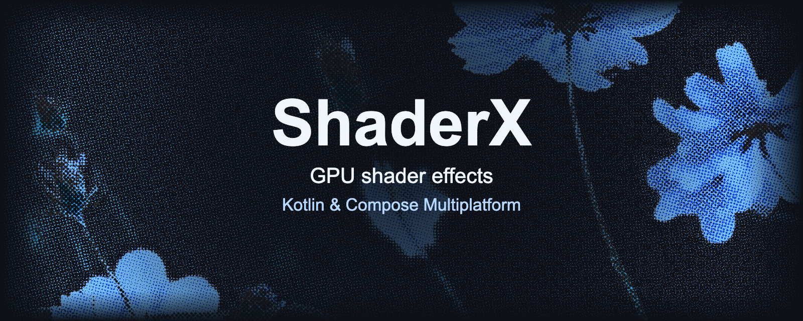
</p>

# ShaderX — shaders for Compose Multiplatform

Turn images, text, and Compose UI into print textures, moving surfaces, or your own AGSL/SkSL effects. Shared Kotlin API for **Android, iOS, desktop, and WebAssembly**.

[](https://central.sonatype.com/artifact/io.github.debanshu777/shaderx)
[](https://github.com/Debanshu777/ShaderX/actions/workflows/ci.yml)
[](LICENSE)

[Gallery](#gallery) · [Get started](#get-started) · [Live app demos](#live-app-demos) · [Documentation](https://debanshu777.github.io/ShaderX/)

<a id="19-ways-to-use-a-shader"></a>

## Gallery

Custom materials, animated type, grain and motion—then the tools to make them your own. Open a preview for a closer look, or follow its effect link for the recipe.

[Effect recipes and platform limits](https://debanshu777.github.io/ShaderX/effects/#applied-ui-recipes).

<table>
  <tr>
    <td width="50%" valign="top">
      <a href="docs/assets/showcase/ui-membership.gif">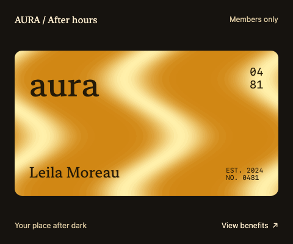</a><br />
      <strong>Gold foil membership</strong><br />
      <a href="https://debanshu777.github.io/ShaderX/custom-effects/#foil-and-scan-recipes">Custom foil</a>
    </td>
    <td width="50%" valign="top">
      <a href="docs/assets/showcase/ui-headline.gif">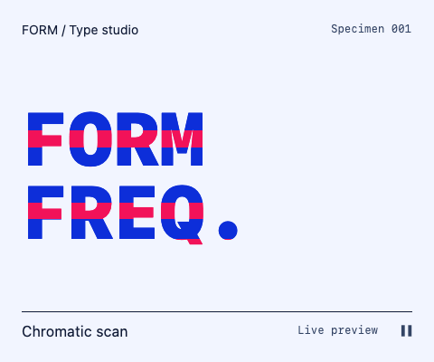</a><br />
      <strong>Chromatic type specimen</strong><br />
      <a href="https://debanshu777.github.io/ShaderX/custom-effects/#foil-and-scan-recipes">Custom scan</a>
    </td>
  </tr>
  <tr>
    <td width="50%" valign="top">
      <a href="docs/assets/showcase/ui-ripple-product.gif">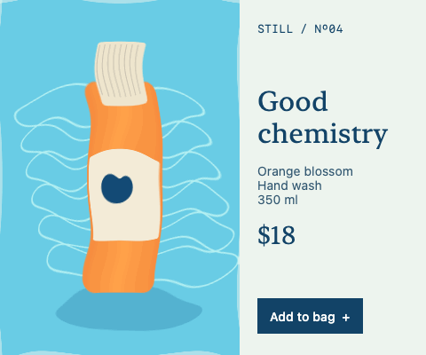</a><br />
      <strong>Skincare product preview</strong><br />
      <a href="https://debanshu777.github.io/ShaderX/effects/#recipe-ripple-product">Ripple</a>
    </td>
    <td width="50%" valign="top">
      <a href="docs/assets/showcase/ui-noise-flow.gif">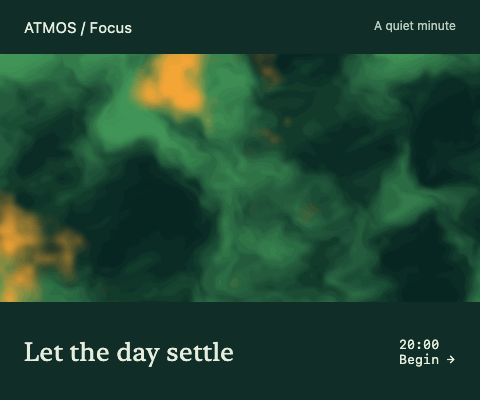</a><br />
      <strong>Atmospheric focus</strong><br />
      <a href="https://debanshu777.github.io/ShaderX/custom-effects/#noise-recipes">Animated layered noise</a>
    </td>
  </tr>
  <tr>
    <td width="50%" valign="top">
      <a id="two-kinds-of-noise"></a><a href="docs/assets/showcase/ui-stipple.png">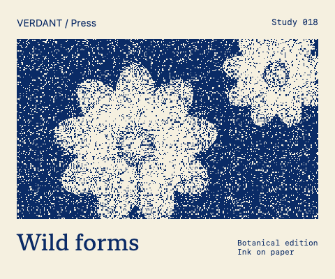</a><br />
      <strong>Stippled botanical print</strong><br />
      <a href="https://debanshu777.github.io/ShaderX/custom-effects/#noise-recipes">Static stochastic noise</a>
    </td>
    <td width="50%" valign="top">
      <a href="docs/assets/showcase/ui-poster.gif">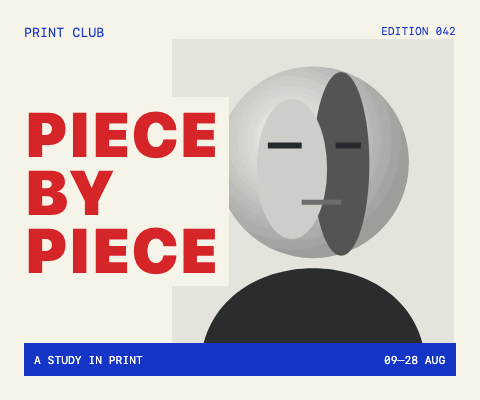</a><br />
      <strong>Halftone art print</strong><br />
      <a href="https://debanshu777.github.io/ShaderX/effects/#recipe-poster">Halftone</a>
    </td>
  </tr>
  <tr>
    <td width="50%" valign="top">
      <a href="docs/assets/showcase/ui-liquid-button.gif">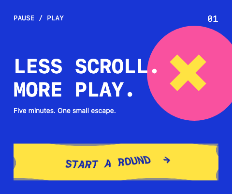</a><br />
      <strong>Arcade call to action</strong><br />
      <a href="https://debanshu777.github.io/ShaderX/effects/#recipe-liquid-button">Wave distortion</a>
    </td>
    <td width="50%" valign="top">
      <a href="docs/assets/showcase/ui-game.gif">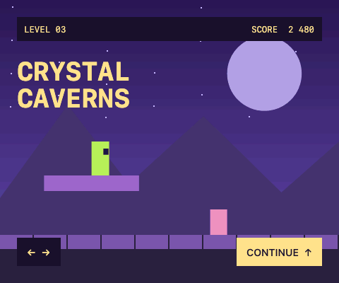</a><br />
      <strong>Dithered platformer</strong><br />
      <a href="https://debanshu777.github.io/ShaderX/effects/#recipe-game">Ordered dither</a>
    </td>
  </tr>
  <tr>
    <td width="50%" valign="top">
      <a href="docs/assets/showcase/ui-album.gif">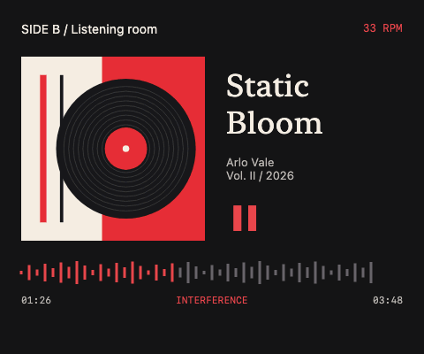</a><br />
      <strong>Chromatic record player</strong><br />
      <a href="https://debanshu777.github.io/ShaderX/effects/#recipe-album">Chromatic aberration</a>
    </td>
    <td width="50%" valign="top">
      <a href="docs/assets/showcase/ui-editor.gif">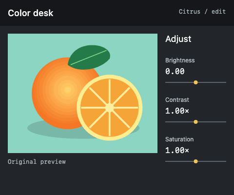</a><br />
      <strong>Citrus color editor</strong><br />
      <a href="https://debanshu777.github.io/ShaderX/effects/#recipe-editor">Color adjustment</a>
    </td>
  </tr>
</table>


[More effect comparisons](https://debanshu777.github.io/ShaderX/effects/#additional-effect-studies): gradients, plasma, grayscale, blur, sepia and pixelation. [Try the apps below](#live-app-demos).


<a id="installation"></a>
<a id="quickstart"></a>

## Get started

This commit targets **0.2.0** for direct stable publication. [Publication status](https://debanshu777.github.io/ShaderX/#releases-and-development-docs).

Add Maven Central to your repositories, then add ShaderX to `commonMain.dependencies` in your shared module:

```kotlin
implementation("io.github.debanshu777:shaderx:0.2.0")
```

Android requires **API 31+ for native blur, API 33+ for AGSL, compile SDK 35+, and Java 17 bytecode**; iOS, JVM desktop, and Wasm use Skia. Contributor builds use **JDK 21**; the current checkout uses **Kotlin 2.3.21 / Compose Multiplatform 1.10.3**. [Setup and version catalogs](https://debanshu777.github.io/ShaderX/getting-started/).

Pass your existing Compose resource or image-loader `Painter`:

```kotlin
import androidx.compose.foundation.Image
import androidx.compose.runtime.Composable
import androidx.compose.ui.Modifier
import androidx.compose.ui.graphics.painter.Painter
import com.debanshu.shaderlab.shaderx.compose.shaderEffect
import com.debanshu.shaderlab.shaderx.effect.impl.GrayscaleEffect

@Composable
fun GrayscalePhoto(painter: Painter, modifier: Modifier = Modifier) {
    Image(
        painter = painter,
        contentDescription = "Grayscale photo",
        modifier = modifier.shaderEffect(GrayscaleEffect(intensity = 1f)),
    )
}
```

Swap in `SepiaEffect()`, `NativeBlurEffect(radius = 8f)`, or `PixelateEffect(pixelSize = 12f)`. The same modifier works on text, cards, and other Compose content.

**Gradle repository setup**

Add Maven Central to your repositories in `settings.gradle.kts`:

```kotlin
dependencyResolutionManagement {
    repositories {
        google()
        mavenCentral()
    }
}
```


**Pause, seek and respect reduced motion**

<a id="animate-with-a-retained-clock"></a>

The ordinary modifier animates built-ins with `Modifier.shaderEffect(WaveEffect(amplitude = 5f, frequency = 9f))`.

For retained pause/seek/speed control, keep playback outside changing effect values. The host supplies lifecycle and reduced-motion preferences.

```kotlin
import androidx.compose.foundation.Image
import androidx.compose.runtime.Composable
import androidx.compose.ui.Modifier
import androidx.compose.ui.graphics.painter.Painter
import com.debanshu.shaderlab.shaderx.compose.controlledShaderEffect
import com.debanshu.shaderlab.shaderx.compose.rememberShaderPlayback
import com.debanshu.shaderlab.shaderx.effect.impl.WaveEffect

@Composable
fun WavePhoto(painter: Painter, active: Boolean, reducedMotion: Boolean) {
    val playback = rememberShaderPlayback(active = active, reducedMotion = reducedMotion)
    Image(
        painter, "Image with wave distortion",
        modifier = Modifier.controlledShaderEffect(
            WaveEffect(amplitude = 5f, frequency = 9f), playback,
        ),
    )
}
```

Optional controls use `playback.isPlaying = false`, `playback.seekTo(2.5)`, and `playback.speed = 0.5`. [Playback, live inputs, and ownership](https://debanshu777.github.io/ShaderX/compose/#controlled-playback-in-development).


**Effects and custom authoring**

| Family | Effects |
| --- | --- |
| Color and image | Grayscale, sepia, gradient, vignette, pixelation, chromatic aberration, invert, native blur |
| Motion and audio | Wave, animated gradient, plasma, ripple, vortex, audio visualizer/distortion |
| Color and print collection | Color adjustment/matrix, ordered dither, halftone |

ShaderX provides editable custom definitions, controlled playback, procedural backgrounds, explicit data/child inputs, ordered Skia chains, support/fallback reports, and bounded Skia PNG export. [Platform limits](https://debanshu777.github.io/ShaderX/platforms/) · [Upgrade guide](https://debanshu777.github.io/ShaderX/migration/) · [Release history](CHANGELOG.md).


## Live app demos

Try the controls yourself in [ShaderX Sampler](https://debanshu777.github.io/ShaderX/sampler/) or [ShaderLab](https://debanshu777.github.io/ShaderX/playground/). Sampler walks through Basic, Custom, Animation and Chain; ShaderLab lets you tune effects, edit shader source and build ordered pipelines.

Prefer running locally? [Download the source ZIP](https://github.com/Debanshu777/ShaderX/archive/refs/heads/main.zip) and follow the [desktop and Android setup](https://debanshu777.github.io/ShaderX/samples/#run-the-apps-locally). See separate run instructions for [ASCII camera](https://debanshu777.github.io/ShaderX/samples/#asciicamera) and [movie carousel](https://debanshu777.github.io/ShaderX/samples/#verticalcarousel).

<table>
  <tr>
    <td width="50%" valign="top">
      <a href="docs/assets/demos/sampler.gif">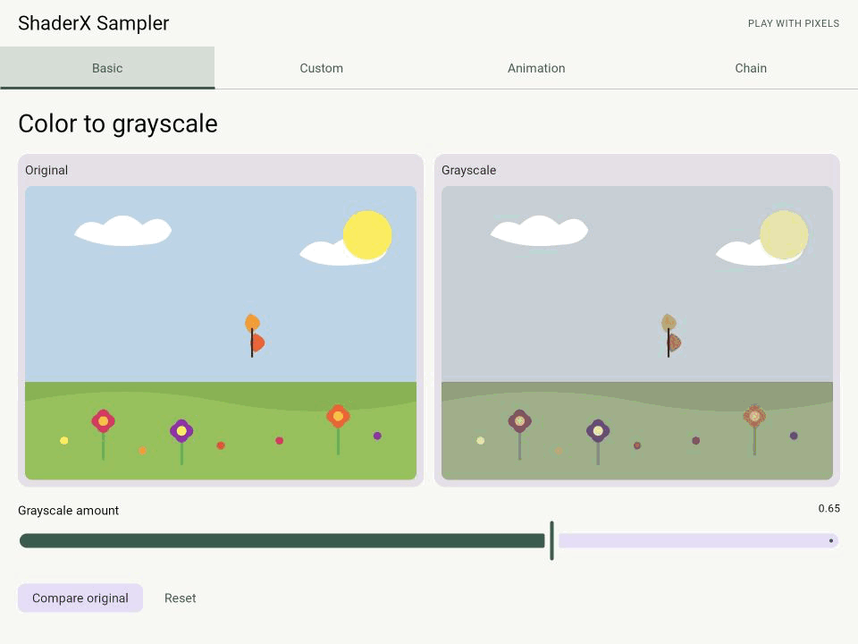</a><br />
      <strong>ShaderX Sampler</strong><br />
      <a href="https://debanshu777.github.io/ShaderX/sampler/">Four playable examples</a>
    </td>
    <td width="50%" valign="top">
      <a href="assets/shader_lab_web.gif">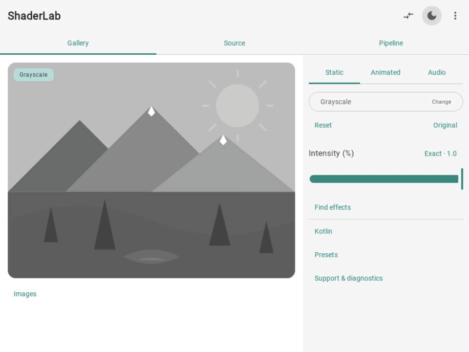</a><br />
      <strong>ShaderLab playground</strong><br />
      <a href="https://debanshu777.github.io/ShaderX/playground/">Gallery · Source · Pipeline</a>
    </td>
  </tr>
  <tr>
    <td width="50%" valign="top">
      <a href="docs/assets/showcase/ui-pipeline.gif">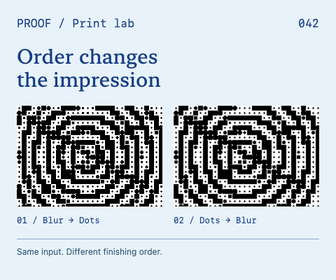</a><br />
      <strong>Optical print proof</strong><br />
      <a href="https://debanshu777.github.io/ShaderX/effects/#recipe-pipeline">Blur → dots / dots → blur</a> · <a href="https://debanshu777.github.io/ShaderX/playground/">Try in ShaderLab</a>
    </td>
    <td width="50%" align="center" valign="top">
      <a href="assets/shader_lab.gif">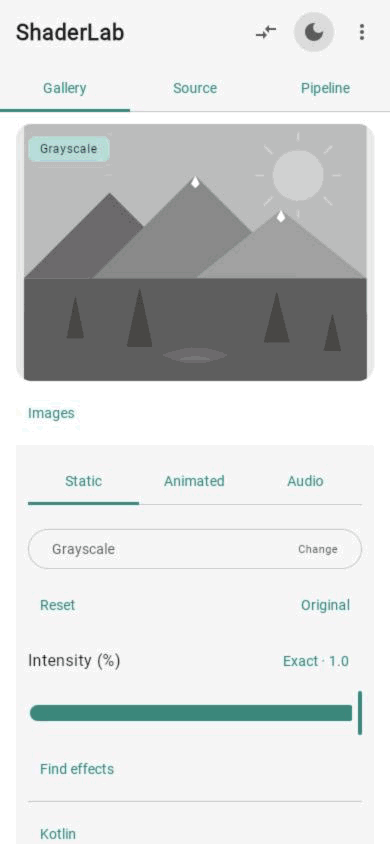</a><br />
      <strong>ShaderLab · narrow browser</strong><br />
      <a href="samples/ShaderLab">Explore the playground</a> · <sub>Sample app</sub>
    </td>
  </tr>
  <tr>
    <td width="50%" align="center" valign="top">
      <a href="assets/ASCIICamera.gif"></a><br />
      <strong>Live ASCII camera</strong><br />
      <a href="samples/ASCIICamera">CameraX + custom shader</a> · <sub>Sample app</sub>
    </td>
    <td width="50%" align="center" valign="top">
      <a href="assets/vertical_carousal.gif"></a><br />
      <strong>Scroll-driven movie cards</strong><br />
      <a href="samples/VerticalCarousel">Scroll + shader parameters</a> · <sub>Sample app</sub>
    </td>
  </tr>
</table>

## Reference

[Custom shaders](https://debanshu777.github.io/ShaderX/custom-effects/) · [Compose and animation](https://debanshu777.github.io/ShaderX/compose/) · [Image processing](https://debanshu777.github.io/ShaderX/image-processing/) · [Coil and Haze](https://debanshu777.github.io/ShaderX/ecosystem/) · [Troubleshooting](https://debanshu777.github.io/ShaderX/troubleshooting/)

Contribute through [CONTRIBUTING.md](CONTRIBUTING.md) and the [setup and validation guide](https://debanshu777.github.io/ShaderX/contributing/). Every code change updates this README and affected guides. Release checks keep the build version, install snippets and changelog aligned; compatibility tests retain published modifier callbacks and Wave copy/destructuring. CI smoke-tests the installed sandboxed Chrome on both OSes and bounds macOS native-build concurrency. [Gallery recipes and capture provenance](https://debanshu777.github.io/ShaderX/effects/#applied-ui-recipes) record effect boundaries and validation limits. [Release plan](docs/release-plan.md) · [Changelog](CHANGELOG.md) · [Publishing and release workflow](https://debanshu777.github.io/ShaderX/maintaining/).

[Apache License 2.0](LICENSE).
