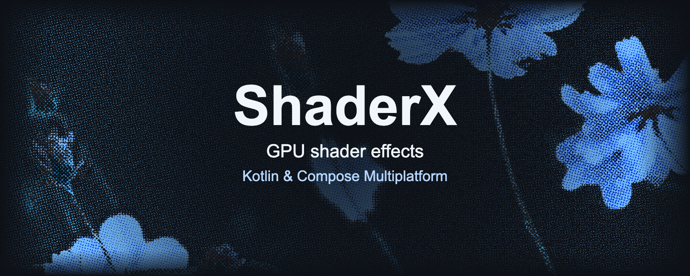

<p align="center">
  
</p>

# ShaderX — GPU shader effects for Compose Multiplatform

ShaderX is a **Kotlin Multiplatform shader library** for **Jetpack Compose and Compose Multiplatform**. Apply grayscale, blur, gradients, pixelation, and custom AGSL/SkSL effects to your UI on **Android, iOS, desktop, and WebAssembly** with `Modifier.shaderEffect`.

[](https://central.sonatype.com/artifact/io.github.debanshu777/shaderx)
[](https://github.com/Debanshu777/ShaderX/actions/workflows/ci.yml)
[](LICENSE)

[Documentation](https://debanshu777.github.io/ShaderX/) · [Live playground](https://debanshu777.github.io/ShaderX/playground/) · [Quickstart](#quickstart) · [Effects](https://debanshu777.github.io/ShaderX/effects/) · [Samples](https://debanshu777.github.io/ShaderX/samples/) · [Contributing](CONTRIBUTING.md)

## See it in motion

Explore live effect controls, transform a camera preview into ASCII art, or make a movie carousel respond to every scroll. These recordings show the sample apps built with ShaderX.

<table>
  <tr>
    <th width="50%">ShaderLab · Android</th>
    <th width="50%">ShaderLab · WebAssembly</th>
  </tr>
  <tr>
    <td align="center"></td>
    <td align="center"></td>
  </tr>
  <tr>
    <td align="center">An effect playground with live parameter controls.<br /><a href="samples/ShaderLab">Explore ShaderLab</a></td>
    <td align="center">The same shared Compose UI in the browser.<br /><a href="https://debanshu777.github.io/ShaderX/playground/">Try it in your browser</a></td>
  </tr>
  <tr>
    <th>ASCIICamera</th>
    <th>VerticalCarousel</th>
  </tr>
  <tr>
    <td align="center"></td>
    <td align="center"></td>
  </tr>
  <tr>
    <td align="center">Custom shaders on a live Android camera feed.<br /><a href="samples/ASCIICamera">Explore ASCIICamera</a></td>
    <td align="center">Scroll-driven effects on movie cards.<br /><a href="samples/VerticalCarousel">Explore VerticalCarousel</a></td>
  </tr>
</table>

[Run the samples →](https://debanshu777.github.io/ShaderX/samples/)

## Installation

Add Maven Central to your repositories in `settings.gradle.kts`:

```kotlin
dependencyResolutionManagement {
    repositories {
        google()
        mavenCentral()
    }
}
```

Add ShaderX to your shared module's `build.gradle.kts`:

```kotlin
kotlin {
    sourceSets {
        commonMain.dependencies {
            implementation("io.github.debanshu777:shaderx:0.1.3")
        }
    }
}
```

For an Android-only Compose app, use the same dependency inside `dependencies { ... }`.
Use **JDK 21**, **Kotlin 2.3.21**, and **Compose Multiplatform 1.10.3** as the starting toolchain. Android requires **minSdk 33**. See [installation and version catalogs](https://debanshu777.github.io/ShaderX/getting-started/).

> **Release status:** `0.1.3` is the published Maven Central release. This branch develops `0.1.4`; session-driven animation, texture uniforms, and the new audio effects are development features. Guides identify those features explicitly. The quickstart below works with `0.1.3`.

## Quickstart

This complete composable takes your app's existing `Painter`, so it works with Compose resources or an image loader without relying on a particular resource name.

```kotlin
import androidx.compose.foundation.Image
import androidx.compose.runtime.Composable
import androidx.compose.ui.Modifier
import androidx.compose.ui.graphics.painter.Painter
import com.debanshu.shaderlab.shaderx.compose.shaderEffect
import com.debanshu.shaderlab.shaderx.effect.impl.GrayscaleEffect

@Composable
fun GrayscalePhoto(painter: Painter, modifier: Modifier = Modifier) {
    Image(
        painter = painter,
        contentDescription = "Photo with a grayscale effect",
        modifier = modifier.shaderEffect(GrayscaleEffect(intensity = 1f)),
    )
}
```

Replace `GrayscaleEffect()` with `SepiaEffect()`, `NativeBlurEffect(radius = 8f)`, or `PixelateEffect(pixelSize = 12f)` from the same `effect.impl` package. The modifier can also transform text, cards, and other Compose content.

## Why use ShaderX?

- **Shared Kotlin API:** AGSL `RuntimeShader` on Android and Skia `RuntimeEffect` on iOS, JVM desktop, and Wasm.
- **Configurable effects:** immutable effect values, typed parameters, and reusable shader compilation caches.
- **Custom shaders:** implement the public `RuntimeShaderEffect` interface to bring your own AGSL/SkSL source.
- **Explicit failures:** handle shader compilation and platform limitations with `ShaderResult` or the modifier's `onError` callback.
- **Examples to explore:** an effect gallery, CameraX ASCII preview, and scroll-driven carousel.

## Platform support

| Platform | Kotlin target / requirement | Backend | Multiple effects with `+` |
| --- | --- | --- | --- |
| Android | API 33+ | AGSL / `RuntimeShader` | Supported |
| iOS | `iosArm64`, `iosSimulatorArm64` | Skia / `RuntimeEffect` | Unsupported |
| Desktop | JVM; Windows, macOS, Linux | Skia / `RuntimeEffect` | Unsupported |
| Web | `wasmJs`; browser with Wasm GC support | Skia / `RuntimeEffect` | Unsupported |

Multi-effect chains on Skia return `ShaderError.UnsupportedEffect`. Android's current offline `ImageProcessor` path returns a processing failure; use the Compose modifier for Android rendering. See the [platform and feature matrix](https://debanshu777.github.io/ShaderX/platforms/) before choosing an API.

## Built-in shader effects

| Available in | Effects |
| --- | --- |
| **0.1.3** | `GrayscaleEffect`, `SepiaEffect`, `GradientEffect`, `VignetteEffect`, `PixelateEffect`, `ChromaticAberrationEffect`, `InvertEffect`, `NativeBlurEffect`, `WaveEffect` |
| **main / 0.1.4 development** | All of the above, plus `AnimatedGradientEffect`, `PlasmaEffect`, `RippleEffect`, `VortexEffect`, `AudioVisualizerEffect`, `AudioDistortionEffect` |

The [effect catalog](https://debanshu777.github.io/ShaderX/effects/) covers parameters and examples. The [Compose guide](https://debanshu777.github.io/ShaderX/compose/) explains animation, Android effect chaining, and cache ownership.

## Samples

| Sample | What it demonstrates | Run / preview |
| --- | --- | --- |
| [ShaderLab](samples/ShaderLab) | Effect gallery, live controls, image loading, and development audio effects | [Playground](https://debanshu777.github.io/ShaderX/playground/) · [Setup](https://debanshu777.github.io/ShaderX/samples/#shaderlab) · [Android recording](assets/shader_lab.gif) · [Web recording](assets/shader_lab_web.gif) |
| [ASCIICamera](samples/ASCIICamera) | Custom shaders on an Android CameraX preview | [Setup](https://debanshu777.github.io/ShaderX/samples/#asciicamera) · [Recording](assets/ASCIICamera.gif) |
| [VerticalCarousel](samples/VerticalCarousel) | Scroll-driven shader parameters on movie cards | [Setup and TMDB token](https://debanshu777.github.io/ShaderX/samples/#verticalcarousel) · [Recording](assets/vertical_carousal.gif) |

Run the desktop gallery from a checkout with JDK 21 and the [Android SDK configured](https://debanshu777.github.io/ShaderX/contributing/#local-setup):

```shell
./gradlew :samples:ShaderLab:composeApp:run
```

## Documentation and contribution

- [Installation and quickstart](https://debanshu777.github.io/ShaderX/getting-started/)
- [Platform support and limitations](https://debanshu777.github.io/ShaderX/platforms/)
- [Custom AGSL/SkSL shaders](https://debanshu777.github.io/ShaderX/custom-effects/)
- [Offline image processing](https://debanshu777.github.io/ShaderX/image-processing/)
- [Troubleshooting](https://debanshu777.github.io/ShaderX/troubleshooting/)
- [Contributor setup and test commands](https://debanshu777.github.io/ShaderX/contributing/)
- [Building GPU Shader Effects for Compose Multiplatform: From Scratch to ShaderX](https://medium.com/gitconnected/building-gpu-shader-effects-for-compose-multiplatform-from-scratch-to-shaderx-326659c4f47b) — the companion article
- [Release history](CHANGELOG.md)

Performance checks cover native-resource disposal, rendered animation, bounded sample-image decoding, and reusable audio processing. Optional allocation diagnostics and the Android export host tests are documented in [performance validation](https://debanshu777.github.io/ShaderX/contributing/#performance-validation). The docs preview bundles the production Wasm playground; see [local validation](https://debanshu777.github.io/ShaderX/contributing/#preview-and-check-documentation).

Development compatibility checks cover the published modifier callback signatures, `WaveEffect` copying and destructuring, and custom factories without animation sessions. See [API compatibility checks](https://debanshu777.github.io/ShaderX/contributing/#api-compatibility-checks).

Bug reports, documentation fixes, and new effects are welcome. Read [CONTRIBUTING.md](CONTRIBUTING.md), then [open an issue](https://github.com/Debanshu777/ShaderX/issues/new/choose) with a reproducible example.

Every code change includes updates to this README and the affected documentation guides. [Agent instructions](AGENTS.md) map changes to guides, and CI checks that both are updated. The [documentation site](https://debanshu777.github.io/ShaderX/) publishes automatically only after a pull request merges into `main` and its documentation build passes; see the [maintainer guide](https://debanshu777.github.io/ShaderX/maintaining/) for the workflow.

Maintainers publish from **Actions → Release ShaderX → Run workflow**, choosing `prerelease`, `patch`, `minor`, or `major`. The workflow calculates the version, tests the library, publishes to Maven Central, and creates a GitHub release with the dependency snippet. Stable releases require `main`; betas can use a feature branch. See the [release workflow guide](https://debanshu777.github.io/ShaderX/maintaining/#release-workflow) for setup and recovery. CI retains platform test reports, and browser tests wait for Skia initialization before running.

## License

ShaderX is released under the [Apache License 2.0](LICENSE).
