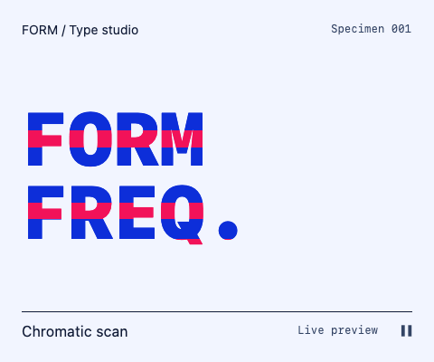
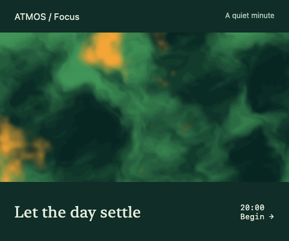

# Custom AGSL and SkSL effects

ShaderX offers a source-plus-bindings path and an editable definition
path. Both produce ordinary runtime effects, with generated immutable updates, getters and
equality. They require no editor, registry, serialization dependency, reflection, or KSP.
You can also [implement `RuntimeShaderEffect`](#low-level-custom-effect)
directly; that interface and `AnimatedShaderEffect` remain supported escape hatches.

## Distinguish content, generation, and backdrop inputs

ShaderX keeps three workflows explicit. `shaderEffect` filters the composable's
rendered content, using the reserved `content` shader input. A [procedural background](compose.md#procedural-backgrounds-in-development)
generates pixels without that input; its definition must not declare or reference `content`.
Additional color-managed images must be supplied explicitly through `ShaderBinding.image` or
a declared frame-image binding. Neither workflow captures surrounding UI as a backdrop.
Sampling a previously captured image remains explicit image-input authoring, with the host
responsible for capture and image lifetime. Automatic glass/backdrop infrastructure is outside SX08.

The existing `ShaderProgram` and `ShaderDefinition` constructors retain their contracts.
Background opt-in is additive, shares the same immutable schema/program, and acquires independent
native state for each consumer. Structural colors stay outside frame providers, including on
Android; reuse an externally owned playback clock when phase should survive value/size changes.
Shader source still needs compilation and rendered validation on each target backend.

## Minimal source and image bindings { #minimal-source-and-image-bindings-in-development }

This complete example adds a caller-owned image input without an editable schema or editor metadata:

```kotlin
import androidx.compose.ui.graphics.ImageBitmap
import com.debanshu.shaderlab.shaderx.authoring.DefinedShaderEffect
import com.debanshu.shaderlab.shaderx.authoring.ShaderBinding
import com.debanshu.shaderlab.shaderx.authoring.ShaderDefinition
import com.debanshu.shaderlab.shaderx.authoring.ShaderProgram

fun imageOverlay(image: ImageBitmap): DefinedShaderEffect = ShaderDefinition(
    id = "example_image_overlay",
    displayName = "Image overlay",
    program = ShaderProgram(
        source = """
            uniform shader content;
            uniform shader overlay;
            half4 main(float2 p) {
                return mix(content.eval(p), overlay.eval(p), 0.5);
            }
        """.trimIndent(),
        bindings = listOf(ShaderBinding.image("overlay", image)),
    ),
).effect()
```

`ShaderBinding.float(name, value)` and `ShaderBinding.color(name, argb)` supply constant scalar
and color values on the same minimal path. Additional images use the existing color-managed
`TextureUniform` backend. They sample in **image pixels**, not normalized UV; scale coordinates
explicitly when an overlay has different dimensions. Bindings do not own or dispose the image.
See the [explicit numerical and nested input contract](#numerical-data-and-nested-inputs-in-development) for supported inputs and bounds.

## Editable static tint { #editable-static-tint-in-development }

Declare each parameter once, retain its exact key, and bind it to a source alias. The adapter
provides typed and legacy getters/updates, descriptor generation and configuration equality:

```kotlin
import com.debanshu.shaderlab.shaderx.authoring.DefinedShaderEffect
import com.debanshu.shaderlab.shaderx.authoring.ShaderBinding
import com.debanshu.shaderlab.shaderx.authoring.ShaderDefinition
import com.debanshu.shaderlab.shaderx.authoring.ShaderProgram
import com.debanshu.shaderlab.shaderx.parameter.ColorParameterDefinition
import com.debanshu.shaderlab.shaderx.parameter.ParameterSchema

object Tint {
    val COLOR = ColorParameterDefinition("example_tint", "color", 0x804080C0L)
    val definition = ShaderDefinition(
        id = "example_tint",
        displayName = "Tint",
        schema = ParameterSchema("example_tint", listOf(COLOR)),
        program = ShaderProgram(
            source = """
                uniform shader content;
                layout(color) uniform half4 tintColor;
                half4 main(float2 p) {
                    half4 sampled = content.eval(p);
                    return half4(tintColor.rgb * tintColor.a, tintColor.a) * sampled.a;
                }
            """.trimIndent(),
            bindings = listOf(ShaderBinding.color("tintColor", COLOR.key)),
        ),
    )

    fun effect(color: Long = COLOR.defaultValue): DefinedShaderEffect =
        definition.effect().withValue(COLOR.key, color)
}

val original = Tint.effect()
val translucentBlue = original.withValue(Tint.COLOR.key, 0x801565C0L)
val argb: Long = translucentBlue[Tint.COLOR.key]
```

The shader premultiplies tint RGB and respects content alpha. Packed colors are unsigned 32-bit
**sRGB ARGB**, including alpha. Declarative colors are structural configuration, never per-frame
updates; changing one replaces the generated session's native state. Android static declarative
color renders also use a fresh native shader, conservatively avoiding in-place color mutation.
This bypasses Android's shared RuntimeShader LRU and may compile on every static creation; animated
sessions already own separate shader instances. This is an ownership/safety tradeoff, with no
measured performance improvement claimed. See the measured [color audit](#color-uniform-audit).

## Animated distortion { #animated-distortion-in-development }

Resolution is a positive finite float2 in physical target pixels; time is finite seconds. Names
such as `viewport` and `elapsed` below are explicit source aliases, independent of parameter IDs:

```kotlin
import com.debanshu.shaderlab.shaderx.authoring.DefinedAnimatedShaderEffect
import com.debanshu.shaderlab.shaderx.authoring.ShaderBinding
import com.debanshu.shaderlab.shaderx.authoring.ShaderDefinition
import com.debanshu.shaderlab.shaderx.authoring.ShaderProgram
import com.debanshu.shaderlab.shaderx.parameter.FloatParameterDefinition
import com.debanshu.shaderlab.shaderx.parameter.ParameterSchema

object Distortion {
    val AMPLITUDE = FloatParameterDefinition(
        "example_distortion", "amplitude", 4f, 0f..32f, unit = "px",
    )
    val definition = ShaderDefinition(
        id = "example_distortion",
        displayName = "Distortion",
        schema = ParameterSchema("example_distortion", listOf(AMPLITUDE)),
        program = ShaderProgram(
            source = """
                uniform shader content;
                uniform float2 viewport;
                uniform float elapsed;
                uniform float strength;
                half4 main(float2 p) {
                    float offset = sin(p.y / viewport.y * 12.0 + elapsed) * strength;
                    return content.eval(p + float2(offset, 0.0));
                }
            """.trimIndent(),
            bindings = listOf(
                ShaderBinding.resolution("viewport"),
                ShaderBinding.time("elapsed"),
                ShaderBinding.float("strength", AMPLITUDE.key),
            ),
        ),
    )

    fun effect(amplitude: Float = AMPLITUDE.defaultValue): DefinedAnimatedShaderEffect =
        definition.animatedEffect().withValue(AMPLITUDE.key, amplitude)
}
```

Pass `Distortion.effect()` directly to `Modifier.shaderEffect`, importing
`com.debanshu.shaderlab.shaderx.compose.shaderEffect`. `withPlayback(false)` pauses time while
live inputs continue refreshing; `withTime(seconds)` supports a caller-managed session. Generated
equality excludes time and includes definition, values, playback flag and provider identity.
The existing modifier may restart time after configuration, playback or size changes;
the [controlled path](compose.md#controlled-playback-in-development) uses an externally owned
timeline that retains phase through these changes. Pass `Distortion.effect()` with the playback
returned by `rememberShaderPlayback` to `controlledShaderEffect`. Controlled time takes precedence
over the generated adapter's `time` and `isAnimating` flag.

## Definition, instance and session ownership

Retain reusable `ShaderProgram` and `ShaderDefinition` declarations outside per-frame work.
A program contains source and binding declarations; a definition adds identity and an optional
schema. Each effect instance owns immutable `ParameterValues` and playback settings. A native
session owns its shader/builder and is closed by the modifier or a manual caller.
Controlled playback is a separate state object: native replacement does not reset it, and sharing
that object synchronizes consumers without sharing mutable shader uniforms.

`displayName` defaults to `id`, so the minimal path needs no presentation metadata:
`ShaderDefinition("overlay", program = program).effect()`. Editable schema fields are GPU-bound
configuration: each must have a binding. Host flags and playback settings stay outside that
schema; use `withPlayback` for the generated animation flag.

The typed editable surface currently covers float, packed sRGB color and boolean values.
Use `ShaderBinding.uniform(FloatUniform("offset", 2f, 3f))` for structural vectors, or pass existing
`IntUniform` / `MatrixUniform` objects (import them from `com.debanshu.shaderlab.shaderx.uniform`).
Numeric arrays are snapshotted at declaration and read time. Full `RuntimeShaderEffect` and
`AnimatedShaderEffect` implementations remain available for custom update/binding behavior.

General editors should read `effect.definition.schema` for nullable bounds, units, step hints,
roles and typed values. The generated legacy `parameters` bridge represents unbounded floats
with the full finite Float range and cannot carry all schema metadata. ShaderLab reads
the rich schema for numeric, color and boolean controls: an unbounded float receives numeric
entry rather than a full-Float-range slider, and toggles send `ParameterValue.BooleanValue`
directly. Units, descriptions, roles and precision hints remain available without quantizing
stored values. See the [playground reuse workflow](samples.md#edit-and-reuse-an-effect-in-development).

### Read binding declarations for tooling

ShaderX exposes `ShaderBinding.descriptor`, a read-only description of the same binding
used at runtime. `ShaderBindingDescriptor` exposes `name`, `kind`, `parameterId` and an optional
`constant` uniform snapshot. `ShaderBindingKind` distinguishes resolution, time, typed schema
parameters, structural constants, image inputs and frame-provider inputs. Reading descriptors
does not evaluate callbacks or allocate native resources. Numeric arrays are copied when reading
`constant`; image handles and callbacks are excluded. Descriptor metadata does not prove a source
uniform's backend type or that the program compiles.

ShaderLab's Kotlin generator uses these declarations, avoiding reflection and a parallel map of
uniform aliases. Portable output retains schema metadata, typed values and the original source
uniform names. Its generated local names use stable numeric suffixes, so Kotlin keywords and
colliding parameter IDs remain valid data rather than invalid variable names. Image and frame
bindings generate caller-input templates, described below; borrowed resources never become
serialized data. The sample registry/project/export model also powers the guided workbench.
Applications remain free to use definitions without registering them.

Generated effects compare definitions by reference. Creating a new definition, including with
the same display ID or source text, conservatively replaces configuration; a display ID never
identifies a compiled program. Source remains the backend compiler cache key for cached paths;
Android generated static colors and all Android animated sessions allocate fresh native shaders.
Skia continues to share compiled source with independent builders. Generated sessions
replace their backend state when definition, values, provider identity, playback flag or target
size changes, and retain the previous session if replacement fails. Separate instances do not
share mutable session uniforms. Legacy sessions retain their existing refresh behavior.

### Binding validation and failure stages

- Declaration construction rejects blank source, invalid or duplicate binding names and the
  reserved `content` name. Declare `content` in source; the backend supplies that input.
- The schema owner must match the definition ID. A binding must use a key from that exact schema;
  same-name keys from a newly constructed declaration are foreign. Every schema parameter needs
  a binding. One key may feed multiple differently named uniforms.
- Immutable updates reject unknown keys, wrong types, non-finite floats and out-of-range values.
  Typed `withValue` accepts explicit `ParameterRangePolicy.CLAMP` for finite numeric bounds.
  Declaration and update failures throw `IllegalArgumentException` before rendering.
- `time` or live declarations require `animatedEffect()`, including when paused. A live provider
  is required exactly when live bindings exist. `ShaderBinding.frameFloat(name)` declares a scalar
  and `ShaderBinding.frameImage(name)` declares an image. A `ShaderFrameProvider`
  returns exactly those names once per call through `uniforms(timeSeconds)`.
- Provider output is fully checked before any setter runs: missing, duplicate or undeclared
  names, wrong kinds, vectors, and non-finite scalars fail validation. Only scalar `FloatUniform`
  and declared `TextureUniform` inputs are allowed; structural colors and generated time cannot
  be overridden. Float payloads are copied before validation. Keep provider identity stable and
  prepare images outside rendering callbacks. Bitmaps are borrowed: callers must keep them valid
  and avoid concurrent content mutation while binding or rendering uses them.
- With `controlledShaderEffect`, publish a complete provider snapshot and change `inputRevision`
  to refresh live values independently of time, including while paused or under reduced motion.
  Keep the provider instance stable; a paused unchanged revision performs no continuous refresh.
  This explicit revision replaces the legacy per-frame polling/`frameDataKey` requirement only
  for the controlled path. Colors stay structural and replace native state safely.
- During factory/session rendering, provider execution and frame validation failures become
  `ShaderError.Unknown`, with effect/binding/stage context and the exception cause. Native source
  compilation or setter failures retain actual compiler/backend diagnostics in
  `ShaderError.CompilationError`, including source. A failed provider callback identifies the
  provider stage; a callback that throws before returning cannot identify a particular uniform.

Apart from the [bounded authored content preflight](#authored-content-input-preflight), ShaderX does **not** parse source to infer missing uniforms, types or portability. The declarations
validate the Kotlin binding contract; native compilers and setters validate the source contract
where their APIs allow it. In particular, omitted source uniforms may use backend defaults rather
than reliably fail. Resolved Skiko 0.9.37.4 also silently ignores an unmatched scalar setter name
and exposes no compiled uniform metadata through its Kotlin API; a render regression test records
this limitation. Test the shader on Android and Skia; no general GLSL translator is implied.

## Low-level custom effect

This complete interface implementation uses the supported low-level runtime contract.

`AbstractRuntimeShaderEffect` and `AbstractAnimatedShaderEffect` use internal parameter handlers. They are implementation helpers for effects inside ShaderX; external consumers cannot implement their internal abstract members.

This effect blends the image with a warm monochrome tint. Its shader preserves premultiplied alpha, and its public parameter methods return immutable copies.

```kotlin
import androidx.compose.runtime.Immutable
import com.debanshu.shaderlab.shaderx.effect.RuntimeShaderEffect
import com.debanshu.shaderlab.shaderx.parameter.ParameterSpec
import com.debanshu.shaderlab.shaderx.parameter.ParameterValue
import com.debanshu.shaderlab.shaderx.parameter.PercentageParameter
import com.debanshu.shaderlab.shaderx.uniform.FloatUniform
import com.debanshu.shaderlab.shaderx.uniform.Uniform

@Immutable
data class WarmTintEffect(val intensity: Float = 0.5f) : RuntimeShaderEffect {
    init {
        require(intensity in 0f..1f) { "intensity must be between 0 and 1" }
    }

    override val id: String = "example_warm_tint"
    override val displayName: String = "Warm tint"
    override val parameters: List<ParameterSpec> = listOf(
        PercentageParameter("intensity", "Intensity", defaultValue = 0.5f),
    )

    override val shaderSource: String = """
        uniform shader content;
        uniform float intensity;

        half4 main(float2 fragCoord) {
            half4 color = content.eval(fragCoord);
            half luminance = dot(color.rgb, half3(0.299, 0.587, 0.114));
            half3 warm = luminance * half3(1.0, 0.75, 0.45);
            return half4(mix(color.rgb, warm, intensity), color.a);
        }
    """.trimIndent()

    override fun buildUniforms(width: Float, height: Float): List<Uniform> =
        listOf(FloatUniform("intensity", intensity))

    override fun withTypedParameter(
        parameterId: String,
        value: ParameterValue,
    ): WarmTintEffect {
        if (parameterId != "intensity") return this
        require(value is ParameterValue.FloatValue) { "intensity requires a float" }
        return copy(intensity = value.value.coerceIn(0f, 1f))
    }

    override fun getParameterValue(parameterId: String): Float =
        if (parameterId == "intensity") intensity else 0f

    override fun getTypedParameterValue(parameterId: String): ParameterValue? =
        if (parameterId == "intensity") ParameterValue.FloatValue(intensity) else null
}
```

Use `Modifier.shaderEffect(WarmTintEffect(intensity = 0.7f))` inside a composable, importing `com.debanshu.shaderlab.shaderx.compose.shaderEffect`.

## Strict schemas { #strict-schemas-in-development }

The schema API can hold configuration without an editor, renderer, reflection, or serialization
library. Start with float, packed sRGB ARGB color, and boolean definitions:

```kotlin
import com.debanshu.shaderlab.shaderx.parameter.BooleanParameterDefinition
import com.debanshu.shaderlab.shaderx.parameter.ColorParameterDefinition
import com.debanshu.shaderlab.shaderx.parameter.FloatParameterDefinition
import com.debanshu.shaderlab.shaderx.parameter.ParameterMetadata
import com.debanshu.shaderlab.shaderx.parameter.ParameterSchema
import com.debanshu.shaderlab.shaderx.uniform.FloatUniform

val amount = FloatParameterDefinition(
    ownerId = "example_config", id = "amount", defaultValue = 0.5f,
    range = 0f..1f, metadata = ParameterMetadata("Amount", description = "Blend strength"),
    step = 0.01f, decimalPlaces = 2,
)
val tint = ColorParameterDefinition("example_config", "tint", 0x801565C0L)
val enabled = BooleanParameterDefinition("example_config", "enabled", true)
val schema = ParameterSchema("example_config", listOf(amount, tint, enabled))
val values = schema.defaults().withValue(amount.key, 0.1234567f)
val uniform = FloatUniform(amount.key.id, values[amount.key])
```

Declare reusable definitions once, outside per-frame work. `ParameterMetadata` supplies label,
description, order, and an optional semantic role; float definitions separately hold bounds,
unit, step, and decimal places. These are hints, not an editor API: the built-in percentage convention uses `unit = "%"`
with normalized 0–1 bounds, but a unit string itself enforces no range. Display steps do not
constrain numeric precision. Frequency alone does not
mean playback speed. Color and boolean definitions have no placeholder ranges.

Invalid defaults, non-finite/reversed bounds, nonpositive/non-finite steps, duplicate/blank IDs,
and mixed owners fail immediately. Typed keys prevent ordinary wrong-type calls at compile time;
dynamic `values.withValue("amount", ParameterValue.FloatValue(...))` validates runtime types
and unknown IDs without coercion (import `ParameterValue` for this dynamic form). All strict
failures use `IllegalArgumentException`, with owner/key context where applicable. Requested
clamping never makes NaN or infinity valid. Packed colors outside `0L..0xFFFFFFFFL` are rejected.

`ParameterSchema.fromLegacy` adapts old descriptors without changing their behavior. The
`valuesFrom` / `applyTo` extensions bridge existing public effect reads/immutable updates;
[the built-in example](effects.md#strict-parameter-snapshots-in-development) includes imports.
A schema owner must equal the target effect ID, and `applyTo` revalidates values against target
legacy descriptors before dispatch. Custom implementations remain responsible for honoring
their declared reads and immutable writes. No internal `ParamHandler` casts are public.

For low-level interfaces, uniform construction remains explicit, as in the `FloatUniform` above.
The definition adapters generate descriptors, bindings and immutable dispatch from
this schema. ShaderLab now uses that schema for generated controls and portable Kotlin output;
the [guided workbench](#guided-source-authoring-in-development) adds explicit source editing and Run.
No new abstract factory or runtime interface requirement is imposed on existing implementations,
and legacy color conversion is unchanged.

## Shader contract

- Declare `uniform shader content;` for the content being transformed.
- Use `half4 main(float2 fragCoord)` as the entry point.
- Sample content using pixel coordinates with `content.eval(fragCoord)`.
- Keep uniform names and dimensions consistent between Kotlin and the shader source.
- Give each effect type a unique, stable ID. Avoid reusing an ID for unrelated shader programs.
- Test source on Android and Skia. AGSL and SkSL have a shared language foundation, but arbitrary GLSL programs are not directly interchangeable with them.

See [Android's AGSL documentation](https://developer.android.com/develop/ui/views/graphics/agsl) and [Skia's SkSL documentation](https://skia.org/docs/user/sksl/) for the shader languages.

The companion article, [Building GPU Shader Effects for Compose Multiplatform: From Scratch to ShaderX](https://medium.com/gitconnected/building-gpu-shader-effects-for-compose-multiplatform-from-scratch-to-shaderx-326659c4f47b), provides background on the project. Follow this guide's interface contract and [platform matrix](platforms.md) when adapting an example to the current library.

## Animated custom effects

External effects can implement `AnimatedShaderEffect`, including `time`, `isAnimating`, `withTime`, and `buildFrameUniforms`. Use configuration-only `equals` and `hashCode`; including time or changing textures tears down session identity. The [animated effect interface](https://github.com/Debanshu777/ShaderX/blob/main/shaderx/src/commonMain/kotlin/com/debanshu/shaderlab/shaderx/effect/AnimatedShaderEffect.kt) defines the contract.

When contributing an effect directly to ShaderX, you can use its internal handler helpers through the abstract base classes. Follow the [contributor checklist](contributing.md#add-an-effect) and register the new built-in effect in `ShaderX.builtInEffects()`.


## Color uniform audit

Declare `layout(color) uniform half4 tint;` when binding a `ColorUniform`. Both Android's
color setter and Skia's runtime builder treat the components as an unpremultiplied sRGB color;
SkSL transforms annotated uniforms to the destination working color space. That space need
not be linear sRGB. A shader returning the tint directly must premultiply it, for example
`return half4(tint.rgb * tint.a, tint.a);`. See [Skia's color-space contract](https://skia.org/docs/user/sksl/#color-spaces).

The legacy `ColorUniform.fromColor` copies components without retaining Compose color-space
metadata. For a wide-gamut Compose color, pass `color.convert(ColorSpaces.Srgb)` using
`androidx.compose.ui.graphics.colorspace.ColorSpaces`. This audit documents current behavior;
it does not silently change conversion for existing callers. The JVM rendered test covers sRGB
and linear-sRGB destinations. SX02 also passed real AGSL tests on a Pixel 9 (Android 17/API 37,
Mali-G715), with explicit FP16 sRGB, linear-sRGB and Display-P3 destinations, translucent alpha,
and a Compose Display-P3 color explicitly converted/packed into sRGB. Android F16 readback may
promote to an extended space; tests preserve that metadata and convert numerically before
comparison. This closes the recorded non-sRGB gate for that device, not all Android hardware/API
levels. Tests require API 34+ HardwareBufferRenderer and skip unsupported FP16 targets explicitly.

Structural image binding descriptors retain `tileModeX` and `tileModeY` without exposing the bitmap.
The shared Kotlin generator emits complete declarative templates accepting caller-owned
`ImageBitmap` arguments. It preserves each binding name and both tile modes, including images
originally declared through `ShaderBinding.uniform(TextureUniform(...))`. Definitions with live
bindings accept a caller-supplied `ShaderFrameProvider`; their composable integration also accepts
`inputRevision: Long`. Retain the provider and increment the revision after publishing a complete
snapshot. The provider supplies every frame binding exactly once; frame-image tile modes belong
to its `TextureUniform`. Generated code never calls a provider to discover data or invents a bitmap.
Built-in audio exports still require a separate integration and report explicit rebinding guidance.

In the gallery, generated code clears when the selected effect or its values change, and failed
generation clears previous output. In the workbench, output instead identifies the last successful
rendered revision and marks it stale when the draft changes.

## Guided source authoring { #guided-source-authoring-in-development }

ShaderLab's **Source** view uses the same public `ShaderDefinition`,
`ParameterSchema`, generated controls and Kotlin generator as the SDK examples. This is sample
functionality built on the documented SDK contracts. Content output runs ShaderX's
Wasm/Skia image-processing path; Background output uses the actual Compose background modifier.
Both reuse the same definition/schema/export workflow; it does not use a second JavaScript shader renderer. Browser
success establishes Skia behavior only. Test exported source independently on Android AGSL.

Start with **Warm tint** and edit the multiline source. Its `intensity` form declares a float,
its default, range `0..1`, label and source uniform binding. Run the shader, then use the generated
control to render a new value revision. To add another input, choose **Add float parameter**,
set its ID/default/range/binding and add the matching source declaration and pixel math. The form
also supports an eight-digit sRGB ARGB color and a strict boolean (`int` in source). Rename
`uniform float intensity;` without changing the form binding and Run: the mismatch identifies
missing source/form names. Correct the binding and Run again before copying the last-good SDK
example. The generated example includes imports, definition, typed values and Compose usage;
it never executes Kotlin in the workbench.

The workbench checks a deliberately narrow declaration subset before invoking the native compiler:
one uniform per declaration; scalar `float`/`half`, `int`, `float2`, `shader`, and
`layout(color) uniform half4`/`float4`. Comments and quoted tokens do not create declarations.
Content output must declare the reserved `content` input, supplied by the workbench. Background
output must omit it and generate its own pixels; all other uniforms need matching form bindings.
The source-free check is conservative and is not native reflection. Arrays, structs,
preprocessor declarations, other layouts and ambiguous declarations are rejected with a supported
subset explanation. This closes the authoring mismatch journey without claiming compiled-uniform
reflection or a general GLSL parser. Broader manual SDK APIs retain their backend behavior.
The actual compiler remains authoritative for shader syntax and pixel math. Compiler logs are
shown as raw text without invented line offsets; declaration-check line numbers refer directly
to the submitted source, with no generated preamble.

Source, form, bindings and current values are editable draft state. Run builds and renders a
complete candidate before promoting its matching revision. A failed Run leaves the draft editable
and retains the previous successful preview/code under a prominent stale label. Late input or
render results cannot promote an older revision. The default SDK export uses the last successful
rendered snapshot; **Download draft file** separately saves possibly broken source/form/value text.
Restore validates file bounds and structure, then requires Run; it restores no validation certificate,
image handle, renderer or last-good output.

Distortion demonstrates pixel offsets and `resolution`; Animated adds seconds through `time`
and retained playback with play/pause/reset. The original/result comparison is a time-zero snapshot;
the animated view uses the retained playback owner. Image input blends a color-managed image,
sampling in pixels with REPEAT X / MIRROR Y. The bundled input works without upload. Browser PNG
selection is bounded to 1 MiB and 256×256; native workbench hosts currently use the bundled input.
This is not a raw data-texture pipeline or an arbitrary frame-provider editor.

Run is explicit. Limits are 32 KiB UTF-8 source, 32 parameters, 128 KiB project text, a 256px
preview input and four cached programs per workbench factory. Local recovery has explicit
**Save draft**, **Restore draft** and **Reset workbench** actions; reset replaces its recovery slot
with Warm tint. Inputs are local and never uploaded. Synchronous Wasm compilation/GPU work has
no reliable interrupt timeout: reload a stuck page, reset, then restore a known draft. These limits
are resource controls, not an execution sandbox. See [recovery](troubleshooting.md#workbench-draft-errors-and-recovery)
and the [sample workflow](samples.md#author-a-custom-shader-in-development).

## Custom children in pipelines { #custom-children-in-development-pipelines }

Custom runtime and animated effects can be ordered with native blur through `CompositeEffect`. Controlled pipeline refresh freezes runtime uniforms before native creation, copies numeric arrays and uses one timestamp for all animated providers. Providers should publish complete snapshots; borrowed images retain caller ownership. Failure in any required child retains the previous whole chain. Source portability and arbitrary spatial sampling still need destination-specific rendered validation; the bounded SX05 test is not a universal bounds guarantee. See [Compose](compose.md#shared-clock-pipelines-in-development).


### Source-free workbench output

Choose the **Background** starter to generate a translucent background with `resolution`
and editable `intensity`. The Content/Background output selector changes source requirements; it
does not rewrite a content-dependent program into a generator. Remove `content` and supply pixel
math before selecting Background for an existing draft. Run creates an independently owned
background snapshot behind the unchanged foreground label. Promotion waits for native snapshot creation and a matching Compose draw invocation; it
is not a GPU presentation or readback certificate. Failed/stale candidates cannot replace
the exact last-good project or its exported output choice.

Background export uses `proceduralBackground()` and `shaderBackground`, retaining typed values,
explicit borrowed image/frame arguments, required playback and input revisions. Draft format 2
stores the output choice; format 1 restores as Content. Restore still requires Run. Content runs
remain unavailable on Android's offline ImageProcessor route; background runs use on-screen AGSL
on supported Android devices. No general shape/text shader brush or automatic backdrop capture
is included.


## Collection definitions as authoring examples

`EffectCollection` uses the same public `ShaderDefinition`, rich
`ParameterSchema` and `ShaderBinding.float` declarations as custom effects. Color adjustment,
color matrix, ordered dither and halftone are content filters; they require `content` and cannot
be relabeled source-free backgrounds. Their definition/value objects contain no playback or
native renderer. Each application of a static effect owns its existing factory/modifier resources.

Read `definition.schema` directly for tooling. Reconstructing it through legacy descriptors
loses units, roles, descriptions and nullable bounds. Twenty bounded scalar matrix fields keep
bindings, controls, typed presets and the existing source exporter on one declaration. The
`ColorMatrix` convenience value defensively copies coefficient arrays and converts them into
that same schema; it does not expose internal parameter handlers. See the
[collection equations and layout](effects.md#editable-color-and-artistic-collection-in-development).

The complete generated collection Kotlin contains source, declarations, bindings, exact current
values, imports and Compose application. The sample registry adds discoverability and persistence,
not a requirement for using the library. ReusePanel presets and a color→dither pipeline demonstrate
the workflow without introducing a second editor or silently flattening rich metadata into a
workbench form. Existing workbench custom starters remain independently editable examples.

## Numerical data and nested inputs { #numerical-data-and-nested-inputs-in-development }

ShaderX separates `DataUniform`/`ShaderBinding.data` from the existing
color-managed `TextureUniform`/`ShaderBinding.image`. `Rgba8Data(width, height, bytes)` snapshots
an exact tightly packed, row-major RGBA8 byte array. Each channel is unsigned byte/255;
alpha is independent numerical data, including nonzero RGB when alpha is zero. Dimensions must
be 1..4096 with exactly width × height × 4 bytes and at most 16 MiB. Long arithmetic validates
before copying; `bytes()` returns a defensive copy. This is eight-bit UNORM, not a floating-point texture.

`DataSampling.NEAREST` and `LINEAR` explicitly select filtering without mipmaps. Pixel centers
are `(x + 0.5, y + 0.5)`; coordinates are pixels, not normalized UV. Clamp, repeat and mirror
use `ShaderTileMode` independently on both axes. A shader must interpret the sampled channels
as data, then construct valid premultiplied output for final rendering. Returning alpha-zero
RGB directly cannot demonstrate preservation through the data input because final color output
is premultiplied. Tests remap independent channels to opaque output first.

`ShaderBinding.nested(name, ShaderNode.snapshot(background, ...))` supplies an explicit source-free
child. Create the background with `ShaderDefinition.proceduralBackground()`. A narrow token-aware check requires single `uniform shader name;` declarations and rejects
comma declarations, shader arrays, preprocessor directives/macros and quoted tokens. Numeric
scalar/vector arrays remain available. Every shader input must have an explicit binding; missing inputs fail during snapshot creation. No child receives
Compose content or a captured backdrop. Child values, dimensions (default 1×1) and time seconds
(default zero) are frozen at snapshot creation. Share the definition/program between siblings;
each native occurrence has independent mutable state. Public immutable construction cannot
create a cycle; defensive traversal also diagnoses cycles. Trees allow at most four node levels
and 32 occurrences, counting repeated siblings separately.

For live values declare `frameData` or `frameNested` and supply the matching `DataUniform` or
`NestedUniform` in a retained `ShaderFrameProvider`. Snapshot creation resolves all child providers;
no child retains a provider or clock. Use independently owned `ShaderPlayback` positions to
construct child snapshots, then publish one complete parent live revision. Parent time never
silently replaces child time. Providers are compared by reference identity. Colors remain
structural, including inside children on Android.

Reusable definitions/data/nodes hold no native shader/image allocations of their own. Image
bindings remain borrowed caller-owned images. Whole input-tree validation precedes backend
compilation and binding. Structural declarations participate in capability queries without
executing providers. Manual runtime implementations must declare hidden requirements through
`querySupport(..., inputs = ...)`; metadata queries never run their source or uniform getters.

Controlled playback with an unchanged paused revision performs no refresh/upload. A refresh
that includes numerical data currently creates and binds a fresh backend input, even when the
same `Rgba8Data` reference is returned; no native upload cache or measured speedup is promised.
Publish a new immutable value and increment `inputRevision` for changed data. Sessions/native
snapshots retain required resources after source-cache eviction; closing a session releases its
owned wrappers/references, while an already returned render snapshot keeps its native dependencies.
Android native resource reclamation remains GC-managed; bitmaps are never recycled under active
snapshots. This is retention correctness, not a memory-stabilization benchmark.

Descriptors expose input kinds, structural sampling/tiles and generic caller-rebinding descriptions.
They never expose application bytes, native handles or providers. Generated Kotlin accepts
`Rgba8Data`, `ShaderNode`, image and live-provider arguments; project files store requirements,
not payloads or portable executable graphs. Adding `DataUniform` and `NestedUniform` deliberately
requires exhaustive source `when (uniform)` callers to handle the new variants. Existing uniform,
program, definition and descriptor constructor signatures remain intact; no mandatory factory
member or new sealed error variant is added. See [platform support](platforms.md) and
[data-input validation record](https://github.com/Debanshu777/ShaderX/blob/main/validation/evidence/sx10-data-and-shader-inputs.json) for exact backend evidence.

### Bounded portable numerical sampler

For small LUTs or normalized FFT bins, `ShaderNode.rgba8Sampler(data, sampling, tileModeX,
tileModeY)` is an explicit alternative implemented with ordinary `float4` uniforms and a
procedural child shader. It supports **at most 64 texels** (256 float components, 1024 uniform
bytes). It validates that cap before copying data. Nearest and four-tap bilinear interpolation
use the pixel centers/tiling rules above; tiling applies per neighbor. This is a bounded
numerical sampler, not a native raw-image API, float texture, or automatic fallback for
`DataUniform`. It requires `NESTED_SHADER` support and becomes a normal immutable `ShaderNode`.
The consuming parent must turn independent channels, including alpha, into valid output color.

The implementation uses constant-index dispatch because dynamic uniform-array indexing is rejected
by the resolved RuntimeEffect compiler. Large data belongs on a backend with a suitable native
raw path. Skia caches compiled child programs; Android creates independent mutable child shaders
when binding. Both rebind native child instances on an actual refresh; no speedup is claimed.
See the [sample producer recipe](samples.md#explicit-data-and-child-input-recipes-in-development).

Child compilation/binding failures preserve the deepest child's original source and an
alias/definition path in the existing `ShaderError.CompilationError`; a workbench must highlight
that source rather than the parent. New data/child bindings also require an explicit parent
`uniform shader name;` before native work. This avoids silent Skiko child-name assignment and an
observed Android native error-path abort for a missing child alias. Parent alias/type errors
remain attributed to the parent source. Existing image/scalar escape-path setter behavior is
unchanged. This narrow new-input preflight rejects macros/ambiguous declarations; it does not
claim general compiled-uniform reflection.


## Authored content input preflight

For defined effects, `.effect()` and `.animatedEffect()` are content-filter adapters. The built-in
factories reject a defined adapter on supported content routes without an explicit top-level `uniform shader content;` before
providers, cache lookup or native filter creation. The same check covers the entire authored
composite graph, pipeline creation/replacement and supported Skia export routes. Failure uses the
existing `ShaderError.CompilationError`, retaining the definition ID and original source, and
suggests `definition.proceduralBackground()` with `Modifier.shaderBackground` for source-free output.
Those explicit source-free background declarations remain valid; no dummy content is added.

The bounded declaration result is cached once per immutable `ShaderProgram`; pipeline refreshes
still check the whole graph before providers without stripping/tokenizing source again. This is
not a shader parser, translator or compiler. Whitespace and
comments between declaration tokens are accepted; comments, local variables and inactive code
cannot stand in for the input. Defined content programs with preprocessor directives/aliases,
quoted tokens, or comma/array declarations for `content` are rejected conservatively. Declare
that scalar child directly. Remaining source validity and binding types still belong to the
backend compiler. Manual `RuntimeShaderEffect`/`AnimatedShaderEffect` source handling is unchanged;
the new authored preflight does not impose this syntax restriction on those legacy escape hatches.
Capability queries remain metadata and do not establish source validity.

## Animated ribbons recipe

This complete example is the original shader used by the foundation
ribbons preview below. It bends a cosine palette with two sine waves, then adds a narrow highlight.
It is a content effect: an opaque white Canvas provides coverage; the shader keeps that alpha
and replaces RGB with premultiplied procedural color. It does not sample a backdrop or model
physical fabric. Keep the declaration and immutable effect instance out of per-frame work.


```kotlin
import androidx.compose.foundation.Canvas
import androidx.compose.foundation.layout.size
import androidx.compose.runtime.Composable
import androidx.compose.runtime.remember
import androidx.compose.ui.Modifier
import androidx.compose.ui.graphics.Color
import androidx.compose.ui.unit.dp
import com.debanshu.shaderlab.shaderx.authoring.ShaderBinding
import com.debanshu.shaderlab.shaderx.authoring.ShaderDefinition
import com.debanshu.shaderlab.shaderx.authoring.ShaderProgram
import com.debanshu.shaderlab.shaderx.compose.controlledShaderEffect
import com.debanshu.shaderlab.shaderx.compose.rememberShaderPlayback

val silk = ShaderDefinition(
    id = "silk",
    program = ShaderProgram(
        source = """
            uniform shader content;
            uniform float2 resolution;
            uniform float time;
            half4 main(float2 p) {
                float2 uv = p / resolution;
                float bend = sin(uv.y * 6.0 + time) * 0.22;
                float ribbons = uv.x * 3.0 + bend
                    + sin(uv.y * 3.0 - time) * 0.18;
                float3 color = 0.62 + 0.32 * cos(
                    6.2831853 * (ribbons + float3(0.0, 0.12, 0.28)));
                float sheen = pow(0.5 + 0.5 * sin(ribbons * 6.2831853), 12.0);
                color = mix(color * 0.82, float3(1.0, 0.94, 0.85), sheen * 0.6);
                half alpha = content.eval(p).a;
                return half4(color * alpha, alpha);
            }
        """.trimIndent(),
        bindings = listOf(ShaderBinding.resolution(), ShaderBinding.time()),
    ),
)

@Composable
fun SilkPreview(active: Boolean, reducedMotion: Boolean) {
    val playback = rememberShaderPlayback(active = active, reducedMotion = reducedMotion)
    val effect = remember { silk.animatedEffect() }
    Canvas(Modifier.size(480.dp,300.dp).controlledShaderEffect(effect,playback)) { drawRect(Color.White) }
}
```

The host passes its current visible lifecycle state as `active` and accessibility preference as
`reducedMotion`. Optional pause/seek/speed controls act on the retained playback object; see
[controlled playback](compose.md#controlled-playback-in-development). Change the palette offsets
or ribbon frequency in `ShaderProgram` for a different surface; source replacement acquires new
native state while controlled time stays external. This recipe was compiled and captured on JVM
Compose/Skia; validate AGSL and each intended target separately. [Capture parameters and provenance](effects.md#readme-gallery-recipes)
distinguish these pixels from the existing flower banner and sample app recordings.


## Foil and scan recipes

The README's gold membership card and type
specimen now use two distinct original programs. `foil` varies a narrow gold palette to suggest
a moving metallic finish; it is an artistic surface, not a physical lighting simulation. `scan`
moves crisp blue/magenta bands inside text. Both sample content alpha and emit premultiplied
RGB, so transparent coverage stays transparent. Neither is a shader Brush or a backdrop capture.

```kotlin
import androidx.compose.foundation.Canvas
import androidx.compose.foundation.layout.size
import androidx.compose.foundation.shape.RoundedCornerShape
import androidx.compose.foundation.text.BasicText
import androidx.compose.runtime.Composable
import androidx.compose.runtime.remember
import androidx.compose.ui.Modifier
import androidx.compose.ui.draw.clip
import androidx.compose.ui.graphics.Color
import androidx.compose.ui.text.TextStyle
import androidx.compose.ui.text.font.FontFamily
import androidx.compose.ui.text.font.FontWeight
import androidx.compose.ui.unit.dp
import androidx.compose.ui.unit.sp
import com.debanshu.shaderlab.shaderx.authoring.ShaderBinding
import com.debanshu.shaderlab.shaderx.authoring.ShaderDefinition
import com.debanshu.shaderlab.shaderx.authoring.ShaderProgram
import com.debanshu.shaderlab.shaderx.compose.controlledShaderEffect
import com.debanshu.shaderlab.shaderx.compose.rememberShaderPlayback

val foil = ShaderDefinition(
    id = "gold_foil",
    program = ShaderProgram(
        source = """
            uniform shader content;
            uniform float2 resolution;
            uniform float time;
            half4 main(float2 p) {
                float2 uv = p / resolution;
                float stripe = 0.5 + 0.5 * cos(uv.x * 12.0
                    + sin(uv.y * 8.0 + time) * 1.3);
                float3 gold = mix(float3(0.82, 0.53, 0.08),
                    float3(1.0, 0.94, 0.67), pow(stripe, 3.0));
                half alpha = content.eval(p).a;
                return half4(gold * alpha, alpha);
            }
        """.trimIndent(),
        bindings = listOf(ShaderBinding.resolution(), ShaderBinding.time()),
    ),
)

val scan = ShaderDefinition(
    id = "chromatic_scan",
    program = ShaderProgram(
        source = """
            uniform shader content;
            uniform float2 resolution;
            uniform float time;
            half4 main(float2 p) {
                float2 uv = p / resolution;
                float line = sin(uv.y * 28.0 + time);
                float3 ink = mix(float3(0.05, 0.18, 0.85),
                    float3(0.95, 0.07, 0.35), step(0.1, line));
                half alpha = content.eval(p).a;
                return half4(ink * alpha, alpha);
            }
        """.trimIndent(),
        bindings = listOf(ShaderBinding.resolution(), ShaderBinding.time()),
    ),
)

@Composable
fun FoilPreview(active: Boolean, reducedMotion: Boolean) {
    val playback = rememberShaderPlayback(active = active, reducedMotion = reducedMotion)
    val effect = remember { foil.animatedEffect() }
    Canvas(
        Modifier.size(432.dp, 238.dp).clip(RoundedCornerShape(12.dp))
            .controlledShaderEffect(effect, playback),
    ) { drawRect(Color.White) }
}

@Composable
fun ScanHeadline(active: Boolean, reducedMotion: Boolean, modifier: Modifier = Modifier) {
    val playback = rememberShaderPlayback(active = active, reducedMotion = reducedMotion)
    val effect = remember { scan.animatedEffect() }
    BasicText(
        "FORM\nFREQ.",
        modifier = modifier.controlledShaderEffect(effect, playback),
        style = TextStyle(
            color = Color.White,
            fontSize = 82.sp,
            lineHeight = 80.sp,
            fontWeight = FontWeight.Black,
            fontFamily = FontFamily.Monospace,
        ),
    )
}
```

The host supplies actual lifecycle and reduced-motion inputs. Membership details are ordinary
dark foreground text above the bright gold surface; only the surface animates. In the type
specimen, the text itself is the filtered content. Both programs repeat after `2π` seconds,
matching the captured six-second GIF loops (6.28 seconds after GIF timing quantization).




[All 19 applied recipes and capture parameters](effects.md#applied-ui-recipes) document the
other effect boundaries. The temporary capture scenes are removed; no app, public helper,
shader brush or dependency is added by these documentation examples.


## Noise recipes

These are two original custom definitions,
not additions to the built-in effect catalog. The static print echoes the banner's ink-on-paper
character with stochastic grain. The animated focus surface uses coherent layered noise.

`stipple` hashes each target-pixel cell into a fixed threshold and compares it with inverse
content luminance. This gives irregular ink coverage rather than a regular halftone grid.
`grainSize = 1.5f` is physical pixels and must stay positive; `amount = 1f` fully applies the
navy/ivory treatment (use 0–1 for blending). There is no time binding or animation session.
The program unpremultiplies sampled RGB before luminance evaluation and premultiplies its output.

`noiseFlow` interpolates lattice values with a cubic smoothstep, sums four octaves with halving
weights and frequency multiplier 2.03, then warps a second noise field with the first. A circular
offset of radius 0.8 samples the field smoothly and repeats after `2π` seconds at 1× playback.
The result is moving emerald/amber cloud structure. It replaces content RGB while preserving
sampled alpha; the opaque white Canvas below supplies the surface coverage. Keep foreground
copy outside that Canvas. Host lifecycle and reduced-motion policy control the retained clock.

```kotlin
import androidx.compose.foundation.Canvas
import androidx.compose.foundation.Image
import androidx.compose.foundation.layout.size
import androidx.compose.runtime.Composable
import androidx.compose.runtime.remember
import androidx.compose.ui.Modifier
import androidx.compose.ui.draw.clipToBounds
import androidx.compose.ui.graphics.Color
import androidx.compose.ui.graphics.painter.Painter
import androidx.compose.ui.unit.dp
import com.debanshu.shaderlab.shaderx.authoring.ShaderBinding
import com.debanshu.shaderlab.shaderx.authoring.ShaderDefinition
import com.debanshu.shaderlab.shaderx.authoring.ShaderProgram
import com.debanshu.shaderlab.shaderx.compose.controlledShaderEffect
import com.debanshu.shaderlab.shaderx.compose.rememberShaderPlayback
import com.debanshu.shaderlab.shaderx.compose.shaderEffect

val stipple = ShaderDefinition(
    id = "stochastic_ink",
    program = ShaderProgram(
        source = """
            uniform shader content;
            uniform float grainSize;
            uniform float amount;
            float hash(float2 cell) {
                return fract(sin(dot(cell, float2(23.17, 91.43))) * 17341.17);
            }
            half4 main(float2 p) {
                half4 sampled = content.eval(p);
                float3 rgb = sampled.a > 0.0 ? float3(sampled.rgb) / sampled.a : float3(0.0);
                float coverage = 1.0 - dot(rgb, float3(0.2126, 0.7152, 0.0722));
                float ink = step(hash(floor(p / grainSize)), clamp(coverage, 0.0, 1.0));
                float3 printed = mix(float3(0.96, 0.94, 0.88), float3(0.04, 0.17, 0.40), ink);
                return half4(mix(rgb, printed, amount) * sampled.a, sampled.a);
            }
        """.trimIndent(),
        bindings = listOf(
            ShaderBinding.float("grainSize", 1.5f),
            ShaderBinding.float("amount", 1f),
        ),
    ),
)

val noiseFlow = ShaderDefinition(
    id = "layered_noise_flow",
    program = ShaderProgram(
        source = """
            uniform shader content;
            uniform float2 resolution;
            uniform float time;
            float hash(float2 cell) {
                return fract(sin(dot(cell, float2(41.73, 289.17))) * 15731.743);
            }
            float valueNoise(float2 p) {
                float2 cell = floor(p);
                float2 f = fract(p);
                f = f * f * (3.0 - 2.0 * f);
                return mix(
                    mix(hash(cell), hash(cell + float2(1.0, 0.0)), f.x),
                    mix(hash(cell + float2(0.0, 1.0)), hash(cell + float2(1.0, 1.0)), f.x),
                    f.y
                );
            }
            float layers(float2 p) {
                float sum = 0.0;
                float weight = 0.5;
                for (int octave = 0; octave < 4; octave++) {
                    sum += weight * valueNoise(p);
                    p = p * 2.03 + float2(4.7, 9.2);
                    weight *= 0.5;
                }
                return sum;
            }
            half4 main(float2 p) {
                float2 uv = (p - resolution * 0.5) / resolution.y;
                float2 orbit = float2(cos(time), sin(time)) * 0.8;
                float n = layers(uv * 3.0 + orbit);
                float warped = layers(uv * 3.0 + float2(1.8 * n, -n) + orbit * 0.5);
                float3 color = mix(float3(0.025, 0.14, 0.13), float3(0.25, 0.58, 0.34),
                    smoothstep(0.2, 0.72, warped));
                color = mix(color, float3(0.96, 0.65, 0.21), smoothstep(0.53, 0.78, n));
                half alpha = content.eval(p).a;
                return half4(color * alpha, alpha);
            }
        """.trimIndent(),
        bindings = listOf(ShaderBinding.resolution(), ShaderBinding.time()),
    ),
)

@Composable
fun StipplePrint(painter: Painter, modifier: Modifier = Modifier) {
    val effect = remember { stipple.effect() }
    Image(
        painter, "Stochastic ink print",
        modifier = modifier.size(432.dp, 258.dp).clipToBounds().shaderEffect(effect),
    )
}

@Composable
fun NoiseSurface(active: Boolean, reducedMotion: Boolean, modifier: Modifier = Modifier) {
    val effect = remember { noiseFlow.animatedEffect() }
    val playback = rememberShaderPlayback(active = active, reducedMotion = reducedMotion)
    Canvas(
        modifier.size(480.dp, 248.dp).clipToBounds()
            .controlledShaderEffect(effect, playback),
    ) { drawRect(Color.White) }
}
```




Both recipes were compiled and rendered through JVM Compose/Skia modifiers. The static frame
was unchanged at two scene times; the animated GIF has 48 distinct native renders over one loop.
Android, iOS and Wasm output is not established by this raster capture; floating-point hash
precision can alter individual grain cells across backends. These recipes use content modifiers,
not shader brushes or automatic backdrops. The README's Paper-rendered CMYK flower banner stays
unchanged and is not represented as a ShaderX capture. See [capture details](effects.md#applied-capture-record).
