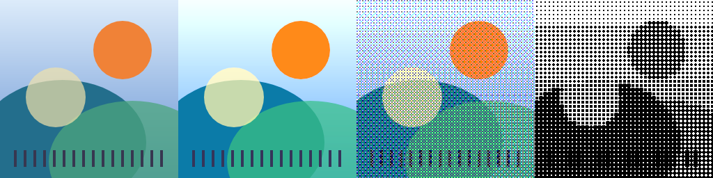
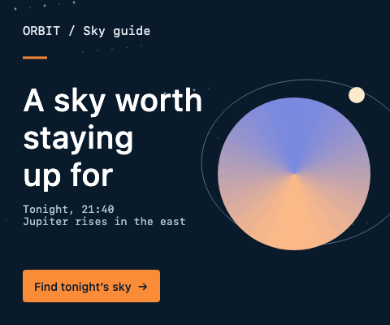
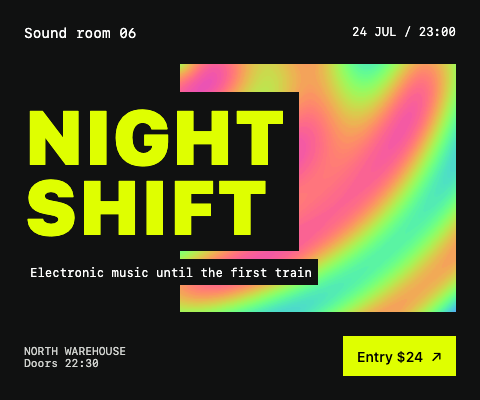
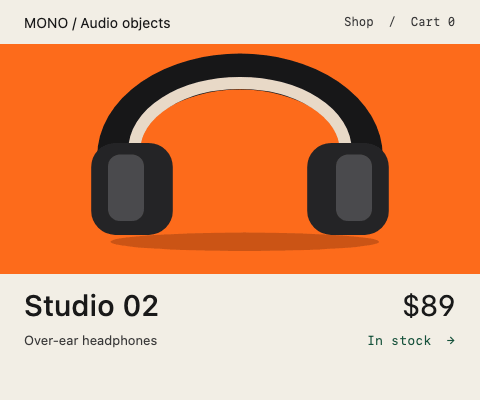
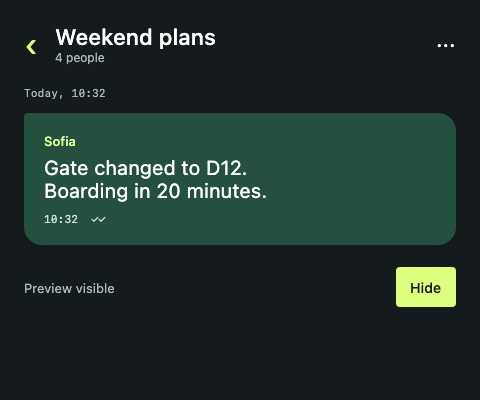
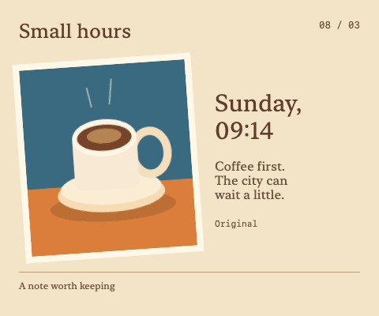
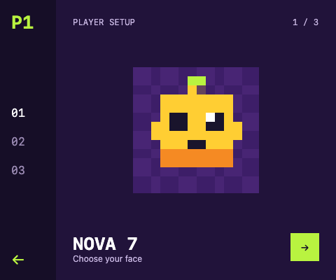
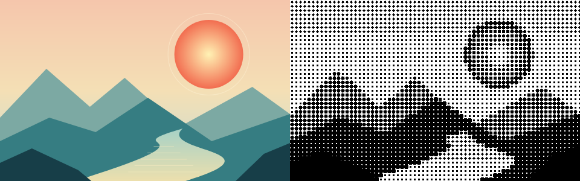
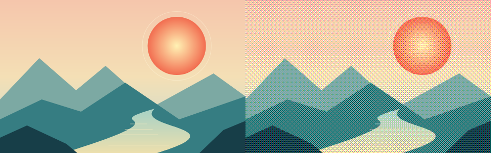
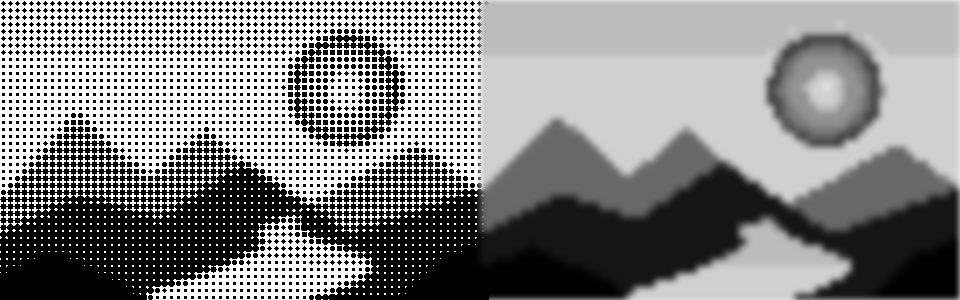

# Built-in shader effects

This catalog documents **ShaderX 0.2.0** and its **19 built-in effects**. The release adds
[color adjustment, color matrix, ordered dither and halftone](#editable-color-and-artistic-collection-in-development),
alongside editable schemas, custom definitions and ordered pipelines. See the
[changelog](https://github.com/Debanshu777/ShaderX/blob/main/CHANGELOG.md) for version history
and [publication status](index.md#releases-and-development-docs) for artifact availability.

Import effects from `com.debanshu.shaderlab.shaderx.effect.impl`. Pass an effect to `Modifier.shaderEffect` as shown in the [quickstart](getting-started.md).

## Color, image and distortion { #published-in-013 }

| Effect | Example | Parameters / purpose |
| --- | --- | --- |
| Grayscale | `GrayscaleEffect(intensity = 1f)` | `intensity`: 0–1; blend with luminance-based grayscale |
| Sepia | `SepiaEffect(intensity = 1f)` | `intensity`: 0–1; warm photograph tone |
| Gradient | `GradientEffect(intensity = 0.5f)` | `color1`, `color2`: ARGB `Long`; `intensity`: 0–1 |
| Vignette | `VignetteEffect(radius = 0.5f, intensity = 0.5f)` | Both parameters: 0–1; darken edges |
| Pixelation | `PixelateEffect(pixelSize = 10f)` | `pixelSize`: 1–100 pixels |
| Chromatic aberration | `ChromaticAberrationEffect(offset = 5f)` | `offset`: 0–20 pixels; separate color channels |
| Invert | `InvertEffect()` | Invert RGB while preserving alpha |
| Native blur | `NativeBlurEffect(radius = 10f)` | `radius`: 0–50 pixels; platform blur |
| Wave | `WaveEffect(amplitude = 10f, frequency = 5f)` | `amplitude`: 0–50 pixels; `frequency`: 1–20; `animate` and `time` |

These are the declared parameter ranges used by ShaderX's parameter API. Constructors and `copy` calls do not uniformly clamp values; keep directly supplied values in range. Legacy `withParameter` and `withTypedParameter` clamp numeric ranges, but retain their historical coercion, unknown-ID, and non-finite behavior. Use the additive strict snapshots below when those inputs must be rejected.

For automatic session-based animation, apply `Modifier.shaderEffect(WaveEffect(...))` as shown in the [Compose guide](compose.md#animated-effects-in-development). Use the retained `ShaderPlayback` clock when explicit timeline control is needed.

## Animated and audio effects { #added-on-main-014-development }

| Effect | Example | Purpose |
| --- | --- | --- |
| Animated gradient | `AnimatedGradientEffect(speed = 1f)` | Rotating gradient with `startColor` and `endColor` |
| Plasma | `PlasmaEffect(scale = 4f, speed = 1f, colorIntensity = 1f)` | Animated plasma colors |
| Ripple | `RippleEffect(frequency = 10f, speed = 1.5f, amplitude = 0.02f)` | Concentric distortion with configurable `decay` |
| Vortex | `VortexEffect(strength = 1f, radius = 0.5f, speed = 1f)` | Centered spiral distortion |
| Audio visualizer | `AudioVisualizerEffect(fftSize = 64f, barColorIntensity = 1f)` | Spectrum bars from an FFT texture |
| Audio distortion | `AudioDistortionEffect(fftSize = 64f, intensity = 1f)` | Content displacement from an FFT texture |

Each supports `animate` and `time`. Audio effects need spectrum data supplied by your app; they do not capture audio themselves. See [live textures](compose.md#live-textures-and-audio-in-development) and the [ShaderLab sample](samples.md#shaderlab).

## Discover and edit parameters

`ShaderX.builtInEffects()` returns the effects shipped with the version you are using:

```kotlin
import com.debanshu.shaderlab.shaderx.ShaderX
import com.debanshu.shaderlab.shaderx.effect.impl.GrayscaleEffect
import com.debanshu.shaderlab.shaderx.effect.impl.GradientEffect
import com.debanshu.shaderlab.shaderx.parameter.ParameterValue

val effects = ShaderX.builtInEffects()
val softer = GrayscaleEffect().withParameter(GrayscaleEffect.PARAM_INTENSITY, 0.5f)
val blueGradient = GradientEffect().withTypedParameter(
    GradientEffect.PARAM_COLOR_1,
    ParameterValue.ColorValue(0xFF1565C0),
)
```

Parameter updates return a new value. Store that value in Compose state to redraw your UI. Built-in static effects typically expose `copy`; animated effects use immutable classes with parameter APIs. Do not assume every effect is a data class.

For exact defaults and the full parameter definitions, browse the [effect source](https://github.com/Debanshu777/ShaderX/tree/main/shaderx/src/commonMain/kotlin/com/debanshu/shaderlab/shaderx/effect/impl) or generate the [API reference](index.md#source-and-api-reference).

## Strict parameter snapshots { #strict-parameter-snapshots-in-development }

`GradientEffect.SCHEMA` and `WaveEffect.SCHEMA` declare typed keys, defaults, validation,
and presentation hints. They also supply the pilots' existing descriptors and uniform names.
The legacy constructors, generated Gradient `copy`/components, string updates, defaults,
and Wave configuration equality remain compatible.

```kotlin
import com.debanshu.shaderlab.shaderx.effect.impl.GradientEffect
import com.debanshu.shaderlab.shaderx.effect.impl.WaveEffect
import com.debanshu.shaderlab.shaderx.parameter.ParameterRangePolicy
import com.debanshu.shaderlab.shaderx.parameter.applyTo
import com.debanshu.shaderlab.shaderx.parameter.valuesFrom

val original = GradientEffect()
val colors = GradientEffect.SCHEMA.valuesFrom(original)
val translucent = colors.withValue(GradientEffect.COLOR_1.key, 0x801565C0L)
val updated = translucent.applyTo(original) as GradientEffect
val alphaRetained = translucent[GradientEffect.COLOR_1.key] // 0x801565C0L
val reset = translucent.reset(GradientEffect.COLOR_1.key)

val wave = WaveEffect(time = 2f)
val values = WaveEffect.SCHEMA.valuesFrom(wave)
val clamped = values.withValue(WaveEffect.AMPLITUDE.key, 75f, ParameterRangePolicy.CLAMP)
val edited = clamped.applyTo(wave) as WaveEffect // amplitude=50, time=2
```

Updates reject wrong types, unknown IDs, foreign keys, NaN, infinity, and finite out-of-range
values with `IllegalArgumentException`. Explicit `CLAMP` only clamps **finite** floats.
Float values retain their precision; display step/decimal hints never quantize them.
`reset()` resets every declared parameter; `reset(key)` resets one. Both preserve the stored `WaveEffect.time`. Compose retains its legacy session restart
behavior after configuration changes; the additive [controlled playback](compose.md#controlled-playback-in-development)
path keeps timeline ownership separate. Old snapshots and effect instances remain unchanged.

Colors are unsigned 32-bit **sRGB ARGB** `Long`s, including alpha, and booleans are real
booleans. Neither has a numeric range. Gradient still blends RGB and preserves the source
image alpha; retaining a color's alpha does not change its historical rendering equation.
Wide-gamut Compose colors require explicit sRGB conversion before packing; see the
[color binding audit](custom-effects.md#color-uniform-audit).

Keys belong to a declaration by reference identity. Reuse `WaveEffect.AMPLITUDE.key`;
constructing another declaration with the same strings does not create an interchangeable
key. The owner ID identifies an effect type, not a session or persisted composite instance.
`ParameterValues.snapshot()` and schema definition lists are defensive snapshots.

For other built-ins, retain `ParameterSchema.fromLegacy(effect.id, effect.parameters)` and
use `schema.valuesFrom(effect)`. This adapter snapshots legacy metadata and ignores nominal
color/toggle ranges; it does not change the original descriptors or update semantics.
Reading an invalid legacy constructor value through a strict snapshot rejects it.
`applyTo` checks owner and target descriptors before invoking public immutable updates.
External effects still implement their existing interface; the schema adds no abstract members.

ShaderLab uses typed schema controls with exact keyboard entry, optional bounded sliders,
arbitrary eight-digit ARGB colors, boolean updates and Reset parameters. Float display hints
never quantize presets or Kotlin output. Wave keeps frequency with the spatial effect parameters
rather than treating it as playback speed. See the [reuse workflow](samples.md#edit-and-reuse-an-effect-in-development).

## Custom definitions { #custom-definitions-in-development }

`ShaderDefinition` combines reusable AGSL/SkSL source and explicit bindings with an optional
strict schema. Its generated static and animated instances implement the existing runtime
interfaces, including immutable typed updates, getters, legacy descriptors and configuration
equality. Minimal effects need no editable metadata; editable effects declare each parameter
once and bind its key to a source uniform alias. See the complete
[tint, distortion and image-input examples](custom-effects.md#minimal-source-and-image-bindings-in-development).

These definitions are not additional built-ins or entries in `ShaderX.builtInEffects()`.
ShaderLab keeps its custom tint/distortion registry sample-local. Color updates are structural
configuration; generated animated equality excludes time. Existing built-in constructor and
legacy update behavior remains unchanged.

## Workbench definitions { #workbench-definitions-in-development }

ShaderLab's Warm tint, pixel distortion, animated distortion and image-input starters are
sample-local authoring examples, not additions to the published built-in catalog. They use
`ShaderDefinition`, the same schema controls and shared Kotlin generator as registered effects.
See [the workbench](samples.md#author-a-custom-shader-in-development) for supported source syntax
and the distinction between editable drafts and last successfully rendered output.

## Ordered pipelines { #ordered-pipelines-in-development }

ShaderX supports ordered native/runtime on-screen composites on Android and Skia. Existing `+` syntax and U+001F index parameter addresses remain intact. These addresses describe the current order; persist explicit instance keys separately and adapt after reorder. The sample pipeline format does this without adding a global SDK registry. See [Compose](compose.md#chain-effects) for shared-clock sessions and failure/lifetime semantics.


## Editable color and artistic collection { #editable-color-and-artistic-collection-in-development }

`EffectCollection` in `effect.impl` exposes reusable
`ShaderDefinition` objects. Call `.effect()` to obtain a static content filter. Each definition's
rich `schema` is shared by validation, bindings, sample controls, presets and complete Kotlin
export. No registry or compiler plugin is needed to apply an effect.

| Definition | Stable ID | Controls and neutral defaults |
| --- | --- | --- |
| `EffectCollection.colorAdjustment` | `color_adjustment` | `brightness` −1…1, default 0; `contrast` 0…2, default 1; `saturation` 0…2, default 1 |
| `EffectCollection.colorMatrix` | `color_matrix` | Twenty `m00`…`m34` coefficients −8…8, identity by default; column 4 is normalized bias |
| `EffectCollection.orderedDither` | `ordered_dither` | `amount` 0…1, default 0; `cellSize` 1…64 px, default 1; `levels` 2…8, default 4; 4×4 Bayer threshold |
| `EffectCollection.halftone` | `halftone` | `amount` 0…1, default 0; `cellSize` 2…64 px, default 8; monochrome ink dots on paper |

```kotlin
import com.debanshu.shaderlab.shaderx.effect.impl.EffectCollection
import com.debanshu.shaderlab.shaderx.parameter.ParameterValue

// Routine callers can use named arguments without parameter-ID strings or casts:
val punch = EffectCollection.adjustColor(brightness = 0.05f, contrast = 1.2f, saturation = 1.25f)
val print = EffectCollection.dither(amount = 1f, cellSize = 2f, levels = 4f)
val dots = EffectCollection.dots(amount = 1f, cellSize = 8f)

// Editors use the same reusable definition and schema:
val definition = EffectCollection.colorAdjustment
val values = definition.schema.defaults()
    .withValue("brightness", ParameterValue.FloatValue(0.08f))
    .withValue("contrast", ParameterValue.FloatValue(1.15f))
val adjusted = definition.effect(values)
```

All new values reject NaN, infinity, wrong types and out-of-range inputs. Explicit strict
`CLAMP` remains available for finite floats. Old effect constructors, copies, coercion and legacy
NaN behavior are unchanged. Float step hints do not quantize a value; dither's discrete palette
choice is rounded explicitly in its shader as documented below.

### Color math and transparent edges

These filters operate on the destination shader's **working color components**. They do not
apply an sRGB transfer function or promise a linear-light or perceptually uniform result. An
sRGB destination and a linear-sRGB destination can therefore yield different adjustments.
Color adjustment first computes `(rgb - 0.5) * contrast + 0.5 + brightness`, then mixes
its weighted gray with that RGB using saturation before clamping. The luminance-like RGB weighting is 0.2126, 0.7152, 0.0722; it is a component-space artistic
weighting when the destination is nonlinear.

Content arrives premultiplied. The filters recover straight RGB for nonzero alpha, apply their
math, clamp output components to 0…1 and premultiply again. Alpha-zero input has straight RGB
zero rather than undefined hidden color. Color adjustment, dither and halftone retain the
source alpha; a matrix may deliberately transform alpha. Neutral settings return sampled content directly; rendered checks allow 2/255 per premultiplied RGBA component.
This preserves content within the renderer's documented pixel tolerance; byte readback is not an exact-float identity
claim at translucent edges.

### Matrix layout

`ColorMatrix(FloatArray)` accepts exactly 20 finite coefficients, each in −8…8. It copies the
input and returns copies through `coefficients`; equality and hash codes use coefficient values.
`ColorMatrix.identity()` produces the neutral matrix and `.effect()` produces a collection
instance using the same twenty scalar schema fields.

Rows are output R, G, B, A. Columns are straight input R, G, B, A, followed by bias:
`out[row] = sum(matrix[row * 5 + column] * in[column], column=0..3) + matrix[row * 5 + 4]`.
Bias is normalized component units: 0.1 adds one tenth, **not** 0.1/255. Clamp straight RGBA
after the transform, then multiply transformed RGB by transformed alpha. For alpha-zero input,
RGB is zero but the matrix can create alpha and visible bias color deliberately. Identity has
ones at indices 0, 6, 12 and 18 and zero elsewhere.

### Artistic sizing and origin

`cellSize` is in physical render-target pixels, not dp or a fraction of image width. Convert dp
using the host's density when a density-independent appearance is desired. Changing render
size preserves the pixel grid size; increasing density without converting changes apparent size.
Dither uses a 4×4 repeating threshold, scaled by `cellSize`; `levels` is a float stored exactly,
then interpreted as `floor(levels + 0.5)` palette levels per channel, with positive half ties upward. Each channel becomes
`floor(clamp(rgb,0,1) * (N-1) + (rank+0.5)/16) / (N-1)`. Halftone samples the cell center
for brightness and uses circular black ink dots on white paper. Dot radius in cell units is
`sqrt(1-gray)/sqrt(2)`; pure black and white have explicit solid endpoint guards, including fractional cell sizes. This is a hard-edged graphic screen, not an area-calibrated print
simulation. It retains each output pixel's original alpha even when the center has a different alpha. Both blend with original RGB
using `amount` in 0…1; zero is the neutral default.

These four implementations are original ShaderX source under the repository's Apache 2.0
license. Bayer ordering and matrix/color arithmetic are standard mathematical constructions;
no shader source was ported from Paper, GPUImage or a gallery. The README flower remains
Paper-rendered brand artwork and is distinct from this content-filter halftone.

Color adjustment, matrix and dither sample content once per output pixel. Non-neutral halftone
also samples the cell center. All add scalar arithmetic; no multipass bloom or benchmark ranking
is implied. Dither and halftone add periodic pixel math. Actual
GPU cost depends on backend, image size and hardware; throughput and native-memory budgets
remain separate validation work. See the [collection validation record](https://github.com/Debanshu777/ShaderX/blob/main/validation/evidence/sx09-effect-collection.json) for evidence and
explicitly deferred exposure/gamma, LUT, grain, bloom and video work.

### Rendered collection comparison



Left to right: original procedural test scene, adjusted color, ordered dither, and halftone.
These are actual JVM Skia raster outputs from `EffectCollectionVisualTest`, not a design mockup.
The dither panel uses three levels per channel and two physical pixels per Bayer entry;
the halftone panel uses six-pixel cells. The synthetic input includes translucent circles
and fine stripes to make edge and detail changes visible. Device screenshots remain separate evidence.

## Numerical inputs for custom effects

Custom definitions can distinguish color-managed pictures from immutable RGBA8
numerical data and bounded source-free child snapshots. These are explicit input kinds, not new
built-in effects or core audio capture. Existing audio/image effect behavior is unchanged. See
[custom input semantics](custom-effects.md#numerical-data-and-nested-inputs-in-development) for
channel, sampling, child-time and caller-rebinding rules.


Custom derivatives of the collection definitions must retain an explicit
`uniform shader content;`. The [authored content preflight](custom-effects.md#authored-content-input-preflight)
rejects missing/ambiguous declarations before provider or native work; source-free generation
uses an explicit procedural background instead of relabeling a content filter.


### Published Wave convenience compatibility

Wave retains its published convenience methods. Review [Wave behavior and binary linkage](migration.md#compatibility-window-and-kinds-of-change) when upgrading; reflection and exhaustive-handler compatibility need separate consideration.

## Applied UI recipes

The applied collection contains **19 examples**: 17 original Compose UI studies and the existing
ASCIICamera/VerticalCarousel recordings. Each study has its own composition, subject and fictional
product copy. The recipe numbers below are stable identifiers, independent of README placement.

The README's curated opening presents ten effect studies. The first row pairs gold foil with
animated type: their material and glyph effects remain recognizable at thumbnail size. Subsequent
rows pair cyan/forest motion, paper/ink treatments, game interfaces, and dark color-editing tools.
Each row uses matching image sizes and consistent captions.

After installation, an always-visible **Live app demos** section groups the current Sampler,
ShaderLab desktop and narrow-browser walkthroughs, the optical pipeline proof, ASCII camera and
carousel. Browser links and [source download/local run instructions](samples.md#run-the-apps-locally)
invite readers to try the actual apps. The optical proof remains an illustrative recipe; its
ShaderLab link opens the app where readers can build and tune a pipeline themselves.

Six simpler or overlapping demonstrations live in [additional effect studies](#additional-effect-studies)
below: gradient, plasma, grayscale, blur, sepia and pixelation. They support learning and reference
without filling the README's opening. All artwork and recordings are preserved; this is editorial
curation, not effect removal. Repository setup, playback controls and the effect catalog are
also always visible in the README, without disclosure toggles.

Buttons, fields, inventory state, playback intent and scroll/camera inputs belong to the host;
ShaderX changes the pixels of the selected layer. The captures do not add reusable app components
to the SDK or claim that every illustrated control is wired in a retained application.

Use effects from `com.debanshu.shaderlab.shaderx.effect.impl` with
`com.debanshu.shaderlab.shaderx.compose.shaderEffect`. For time-driven built-ins, the ordinary modifier owns an animation session. The animated captures instead use the
checkout's paused `ShaderPlayback` and `controlledShaderEffect` to seek deterministic frames;
the capture controls belong to the documented playback API.
All dimensions below are physical pixels at density 1; scaling the same pixel parameters can
change the apparent texture. Each new study's constructor was compiled in the temporary capture test.

| README example | Exact effect snapshot | Affected layer |
| --- | --- | --- |
| <a id="recipe-onboarding"></a>1. Sky guide onboarding | `AnimatedGradientEffect(startColor = 0xFF213BCB, endColor = 0xFFFA8B37, speed = 1f)` | A clipped opaque planet layer; navigation, orbit lines, text and action stay outside the shader. |
| <a id="recipe-event"></a>2. Night Shift event poster | `PlasmaEffect(scale = 4f, speed = 1f, colorIntensity = 1.1f)` | A clipped plasma panel sits behind black-backed poster typography; event details stay sharp. |
| <a id="recipe-liquid-button"></a>3. Arcade call to action | `WaveEffect(amplitude = 5f, frequency = 9f)` | The clipped yellow button and its label share a Wave layer; the cobalt interface is unaffected. |
| <a id="recipe-ripple-product"></a>4. Skincare product preview | `RippleEffect(frequency = 24f, decay = 1.4f, speed = 1f, amplitude = 0.025f)` | Only the clipped bottle-and-water illustration ripples; product information and purchase action remain separate. |
| <a id="recipe-membership"></a>5. Gold foil membership | `foil.animatedEffect()` | A bright gold content layer supplies the card surface; dark serif details are unchanged foreground content. |
| <a id="recipe-headline"></a>6. Chromatic type specimen | `scan.animatedEffect()` | Apply the original scan program directly to opaque white text; sampled glyph alpha masks premultiplied output. |
| <a id="recipe-unavailable"></a>7. Headphone availability | `GrayscaleEffect(intensity = 1f)` | Only the original headphone-and-orange-stage illustration is filtered; price and stock state are host UI. |
| <a id="recipe-privacy"></a>8. Hidden chat preview | `NativeBlurEffect(radius = 7f)` | Blur the message bubble itself, not a backdrop. Intermediate frames are labelled as a privacy transition. |
| <a id="recipe-journal"></a>9. Café journal | `SepiaEffect(intensity = 0.9f)` | Filter the coffee illustration inside its rotated paper frame; serif notes and date remain unchanged. |
| <a id="recipe-avatar"></a>10. Pixel character setup | `PixelateEffect(pixelSize = 13f)` | A clipped square character illustration is pixelated; the sidebar, player name and action stay sharp. |
| <a id="recipe-album"></a>11. Chromatic record player | `ChromaticAberrationEffect(offset = 9f)` | Filter the clipped vinyl cover only; track information, transport and illustrative waveform are separate host UI. |
| <a id="recipe-editor"></a>12. Citrus color editor | `EffectCollection.adjustColor(brightness = 0.02f, contrast = 1.35f, saturation = 1.4f)` | The clipped citrus artwork is adjusted; the inspector displays the same values and normalized slider positions. |
| <a id="recipe-poster"></a>13. Halftone art print | `EffectCollection.dots(amount = 1f, cellSize = 7f)` | Only the portrait is halftoned; the paper-backed display type and blue footer remain unchanged. |
| <a id="recipe-game"></a>14. Dithered platformer | `EffectCollection.dither(amount = 1f, cellSize = 2f, levels = 4f)` | Filter the original game-world artwork; title, score and controls remain separate foreground content. |
| <a id="recipe-pipeline"></a>15. Optical print proof | `NativeBlurEffect(radius = 3f) + EffectCollection.dots(amount = 1f, cellSize = 7f)` | Two explicitly clipped optical-art previews use opposite on-screen filter orders; the right reverses the left. |
| <a id="recipe-stipple"></a>16. Stippled botanical print | `stipple.effect()`; grain size `1.5f`, amount `1f` | Static stochastic threshold noise turns the clipped flower illustration into navy ink on ivory; editorial copy stays separate. |
| <a id="recipe-noise-flow"></a>17. Atmospheric focus | `noiseFlow.animatedEffect()` | Four-octave, domain-warped value noise fills a clipped opaque Canvas; title, timer and action stay sharp. |
| 18. Live ASCII camera | Sample-local `AsciiArtEffect` | Existing Android CameraX recording; [source](https://github.com/Debanshu777/ShaderX/blob/main/samples/ASCIICamera/composeApp/src/commonMain/kotlin/com/debanshu/asciicamera/shader/AsciiArtEffect.kt). This is not an SDK built-in. The sample owns permission, preview and input. |
| 19. Scroll-driven movie cards | Sample-local `CarouselEffect` | Existing VerticalCarousel recording; [source and constructor](https://github.com/Debanshu777/ShaderX/blob/main/samples/VerticalCarousel/src/main/kotlin/com/debanshu/verticalcarousel/effect/CarouselEffect.kt). Its host supplies viewport distance, direction and scroll velocity. |

For recipe 15, use `dots + blur` for the second preview. Import
`com.debanshu.shaderlab.shaderx.effect.plus`. This is an on-screen Compose chain, not an offline
export. Neither panel silently drops
a failed child. The foreground type in recipes 1, 2 and 5 is separate Compose content,
not text that has been recolored by the background shader. Each scene has its own composition, palette, typography and original subject. Shader layers are
explicitly clipped to their intended frames. For rectangular artwork, use
`Modifier.clipToBounds().shaderEffect(...)` with `androidx.compose.ui.draw.clipToBounds`;
use an outer shape clip for a circular or rounded target. Text sits on calm opaque areas: black strips in the
club poster, a paper strip in the art print, and a separate inspector in the image editor. The liquid button deliberately filters its label
and yellow fill together. Its card copy is outside the affected layer.

Recipe 5 uses an original gold-foil program on opaque content. Recipe 6 uses a separate
chromatic-scan program on **white glyph content**, sampling alpha as a mask and emitting
premultiplied color. See the complete [foil and scan definitions](custom-effects.md#foil-and-scan-recipes).
Recipes 16 and 17 add [static stipple and animated layered noise](custom-effects.md#noise-recipes).
These use content modifiers; they do not expose a shader Brush or capture a backdrop.
The privacy example blurs its own message body, not surrounding UI; blur is visual concealment,
not secure redaction. Real applications decide whether sensitive content should be composed at all.

### Additional effect studies

These examples focus on accessible starting points and everyday UI behavior. They remain actual
Compose/Skia captures with the parameters and layer boundaries recorded in the table above.

<table>
  <tr>
    <td width="50%" valign="top">
      <a href="assets/showcase/ui-onboarding.gif"></a><br />
      <strong>Sky guide onboarding</strong><br />
      <a href="https://debanshu777.github.io/ShaderX/effects/#recipe-onboarding">Animated gradient</a>
    </td>
    <td width="50%" valign="top">
      <a href="assets/showcase/ui-event.gif"></a><br />
      <strong>Night Shift event poster</strong><br />
      <a href="https://debanshu777.github.io/ShaderX/effects/#recipe-event">Plasma</a>
    </td>
  </tr>
  <tr>
    <td width="50%" valign="top">
      <a href="assets/showcase/ui-unavailable.gif"></a><br />
      <strong>Headphone availability</strong><br />
      <a href="https://debanshu777.github.io/ShaderX/effects/#recipe-unavailable">Grayscale</a>
    </td>
    <td width="50%" valign="top">
      <a href="assets/showcase/ui-privacy.gif"></a><br />
      <strong>Hidden chat preview</strong><br />
      <a href="https://debanshu777.github.io/ShaderX/effects/#recipe-privacy">Native blur</a>
    </td>
  </tr>
  <tr>
    <td width="50%" valign="top">
      <a href="assets/showcase/ui-journal.gif"></a><br />
      <strong>Café journal</strong><br />
      <a href="https://debanshu777.github.io/ShaderX/effects/#recipe-journal">Sepia</a>
    </td>
    <td width="50%" valign="top">
      <a href="assets/showcase/ui-avatar.gif"></a><br />
      <strong>Pixel character setup</strong><br />
      <a href="https://debanshu777.github.io/ShaderX/effects/#recipe-avatar">Pixelation</a>
    </td>
  </tr>
</table>

### Applied capture record

All 17 new UI studies are actual **480 × 400 JVM Compose/Skia raster renders** made with a temporary
`ImageComposeScene`. A single retained factory served the studies; each scene closed before the
factory and borrowed source image were released. The harness, compiler-check sources and capture
code were removed after verification. No new app, module, dependency or retained generator was added.
The applied subjects are original Compose Canvas drawings: headphones, coffee, a game character,
a vinyl record, citrus, a geometric portrait, a platformer world, a product bottle and optical rings.
The other scenes use text, original procedural programs and ordinary Compose layout. No single
landscape is reused across the applied gallery. The separate [landscape source](assets/showcase/original.png)
still belongs to the standardized foundation comparisons below; it is not the applied gallery input.

The original 15 applied studies are GIFs with 48 captured frames each. The six time-driven files
`ui-onboarding.gif`, `ui-event.gif`, `ui-liquid-button.gif`, `ui-ripple-product.gif`,
`ui-membership.gif`, and `ui-headline.gif` each have 48 distinct rendered frames. Each frame seeks to
`2π × frameIndex / 48` seconds; the duplicate endpoint is omitted. Explicit built-in speed is 1
where supported; Wave's frequency is spatial, not speed. Each source equation repeats at `2π`
seconds. GIF cumulative times are rounded to centiseconds, giving 13/14 cs delays and 6.28 seconds
per loop at nominal 1× speed. The layout and foreground remain actual Compose pixels in every
frame. GIF encoding uses macOS ImageIO palette conversion only; no motion interpolation, AI image,
external filter or post-render UI composition was applied. Check quarter frames and the seam after
recapture. These are illustrative raster studies, not physical-device captures or frame-rate claims.

The two noise additions use the same native capture path. `ui-stipple.png` is a single static
render; PNG bytes matched after advancing scene time from zero to nine seconds. Its deterministic
cell hash has no time binding. `ui-noise-flow.gif` has 48 distinct frames sampled at the same
`2π × frameIndex / 48` times and encoded into a 6.28-second loop. A circular sampling offset makes
the continuous source equation periodic. Decoded quarter frames and the last-to-first transition
were inspected. The botanical drawing is original Compose Canvas artwork; the animated surface
is entirely procedural. The header remains separate Paper-rendered CMYK brand artwork.

The other nine GIFs animate actual immutable effect values through Compose, with
`progress = (0.5 - 0.5 * cos(phase)).toFloat()` and `phase = 2π × frameIndex / 48`.
They move smoothly to an edited state and return; mirrored phases deliberately repeat states.
Native blur/pixel quantization can merge additional neighboring states.
There is no post-render crossfade. The exact animated ranges are:

| Study | Value driven by progress `p` |
| --- | --- |
| Unavailable product | Grayscale intensity `p`; the host's stock pill changes at `p > 0.5` |
| Private message | Blur radius `7 × p`; hidden/visible/transition and reveal/hide labels follow the host state |
| Journal | Sepia intensity `0.9 × p`; original/vintage label follows the host state |
| Avatar | Pixel size `13 - 12 × p`, revealing the avatar and returning to pixelation |
| Album artwork | Chromatic offset `9 × p` pixels |
| Editor | Brightness `0.02 × p`, contrast `1 + 0.35 × p`, saturation `1 + 0.4 × p`; labels and slider positions use those same values |
| Poster | Halftone amount `p`, seven-pixel cells |
| Game screen | Dither amount `p`, two-pixel cells, four levels per channel |
| Pipeline chooser | Blur radius `0.5 + 2.5 × p` in both orders; dot amount stays 1 |

The retained nine `ui-*.png` files are matching still posters of these updated studies,
useful when motion is undesirable. They are not extra use cases. The two existing app recordings are
unchanged, with their existing provenance and [run instructions](samples.md). They are not
recordings of the disposable UI studies. The flower banner and four established app-recording paths remain inline in the README.
The camera/carousel GIFs are unchanged; the ShaderLab paths now contain fresh desktop/narrow
browser captures, and a fifth app recording demonstrates the current four-tab Sampler.
See [current recording provenance](samples.md#current-readme-recordings) for dimensions, flows
and the distinction between browser viewports and physical devices.

The 20 November art-direction revision used the product-specific design process in
[Unslop by Damir Sokolovsky](https://github.com/heydamir/unslop/blob/main/skills/unslop/SKILL.md)
(CC BY 4.0). The adaptation keeps effect demonstrations vivid while giving each fictional product
its own visual world. The README organization applies the same quiet framing and consistent
caption rhythm while retaining the artwork and motion. The curation pass places material/type
effects first, pairs previews by tone and purpose, and moves instructional comparisons here.
It adds no claim of measured exposure or conversion gains. The illustrations, UI layouts and shader equations here are original; no
reference UI, third-party image or executable skill script was copied into the checkout.

## README gallery recipes

The foundation comparisons below are actual **JVM Compose/Skia raster captures**
that support the applied recipes above.
A temporary `ImageComposeScene` applied the public `shaderEffect` and `controlledShaderEffect`
modifiers to Compose Canvas content, with a retained caller-owned factory and error callbacks.
Captured pixels were not altered with an external photo filter, AI generation or mock shader output. The temporary test and capture tools were
removed from the checkout; these media and documentation recipes are the retained artifacts.
They are illustrative renders, not physical-device screenshots or performance measurements.

The landscape is original artwork for ShaderX under the repository's Apache 2.0 license:
a peach-to-cream sky, coral radial-gradient sun, three polygonal teal ridges, a pale curved river,
and five short reflection strokes. Each panel is 480 × 300 physical pixels at density 1.
Comparison PNGs place two panels side by side at 960 × 300; there is no post-render filtering.
The flower banner is unchanged Paper-rendered brand artwork, with separate
[provenance](maintaining.md#reference-projects-and-editorial-choices); it is not evidence of ShaderX's halftone output.

| Media | Actual recipe / comparison |
| --- | --- |
| `halftone.png` | Original → `EffectCollection.dots(amount = 1f, cellSize = 7f)` |
| `dither.png` | Original → `EffectCollection.dither(amount = 1f, cellSize = 2f, levels = 4f)` |
| [`wave.gif`](assets/showcase/wave.gif) | `WaveEffect(amplitude = 16f, frequency = 9f)` with controlled playback |
| `silk.gif` | [Complete original ribbons definition](custom-effects.md#animated-ribbons-recipe), opaque white Canvas input |
| `chain.png` | Left: `NativeBlurEffect(radius = 3f) + dots`; right: `dots + NativeBlurEffect(radius = 3f)`, using the halftone settings above |







The chain uses the on-screen Compose route, not offline `ImageProcessor`. Import
`com.debanshu.shaderlab.shaderx.effect.plus` for `+`; constructors live in
`com.debanshu.shaderlab.shaderx.effect.impl`. Both artistic examples explicitly set `amount = 1f`
because their defaults are neutral. Blur before halftone retains crisp output dots; blur after
halftone softens them. See [ordered composition](compose.md#chain-effects) for version/platform limits.

Each GIF has 48 distinct 480 × 300 frames sampled at `2π × frameIndex / 48` seconds, omitting the
duplicate endpoint. Both shader equations are periodic at `2π` seconds. GIF frame delays round
each cumulative sample time to centiseconds (13 or 14 cs per frame, 6.28 seconds total), preserving
nominal 1× playback. Encoding uses macOS ImageIO's GIF palette conversion only; no motion is
interpolated or generated after capture. Inspect the first, quarter, half, three-quarter and final
frames as well as the loop seam after any recapture. Palette quantization is inherent in GIF;
the PNG comparisons retain full color.

The preview-plus-short-call layout was inspired by the primary
[Paper shader catalog](https://shaders.paper.design/) and
[React Bits component gallery](https://github.com/DavidHDev/react-bits).
No third-party source or gallery assets were copied into these new captures; the landscape and
ribbon equations are original. These visual references do not imply API or feature parity.
