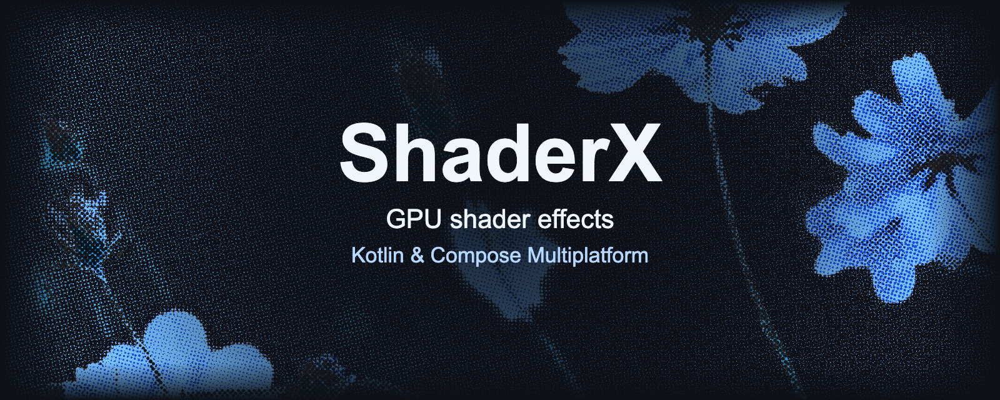
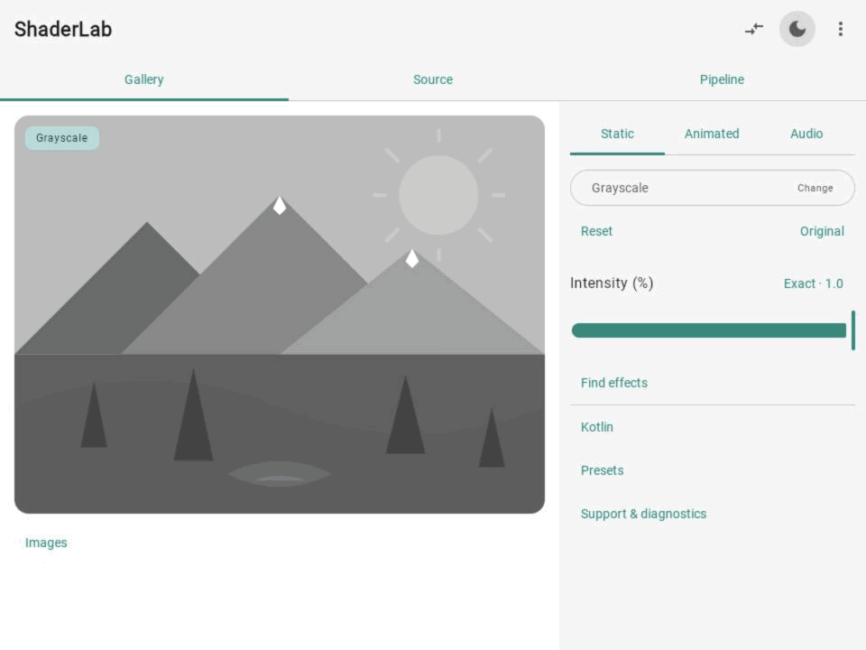

# ShaderX: GPU shader effects for Compose Multiplatform

{ .shaderx-banner width=1600 height=640 fetchpriority=high }

ShaderX is a Kotlin Multiplatform library for applying GPU shader effects to Compose UI. Use the same Kotlin API for Android's AGSL backend and the Skia backend on iOS, JVM desktop, and WebAssembly.

Start with grayscale, blur, gradients, or pixelation, then write a custom AGSL/SkSL shader when you need a different effect.

[Get started](getting-started.md){ .md-button .md-button--primary }
[Explore the effects](effects.md){ .md-button }
[Try the playground](playground/){ .md-button }

## See ShaderX in action

[{ .shaderx-demo width=640 height=480 loading=lazy }](playground/)

The [sample gallery](samples.md) includes current Sampler and ShaderLab browser walkthroughs, a live ASCII camera, and a scroll-driven movie carousel, with source code and run commands for each.

For the project's background, read the companion article, [Building GPU Shader Effects for Compose Multiplatform: From Scratch to ShaderX](https://medium.com/gitconnected/building-gpu-shader-effects-for-compose-multiplatform-from-scratch-to-shaderx-326659c4f47b). Use these guides for the current API and platform limitations.

## Start building

| I want to… | Start here |
| --- | --- |
| Add ShaderX to an app | [Installation and quickstart](getting-started.md) |
| Check my target platforms | [Platform support](platforms.md) |
| Choose an effect | [Effect catalog](effects.md) |
| Animate effects or handle errors | [Compose integration](compose.md) |
| Write an AGSL/SkSL shader | [Custom effects](custom-effects.md) |
| Process image bytes | [Image processing](image-processing.md) |
| Run an example | [Sample applications](samples.md) |
| Fix a setup problem | [Troubleshooting](troubleshooting.md) |
| Upgrade an existing integration | [Migration and readiness](migration.md) |
| Contribute a change | [Contributor guide](contributing.md) |

## Release documentation { #releases-and-development-docs }

These guides document **ShaderX 0.2.0**, including editable custom definitions, strict schemas,
controlled playback, collection effects, ordered Skia chains, procedural backgrounds,
data/child inputs, operation capabilities/fallback and bounded Skia export. Android native blur
works from API 31; AGSL effects require API 33. The library AAR requires minCompileSdk 35 and
uses Java 17 bytecode; contributors use JDK 21.

**Publication status:** this release is prepared in source for direct stable publication after
the release commit. Maven Central's latest verified artifact is **0.1.4**, checked on
20 November 2026 against [official metadata](https://repo.maven.apache.org/maven2/io/github/debanshu777/shaderx/maven-metadata.xml).
The `0.2.0` dependency examples are the release coordinate and become resolvable when publication
completes. Verify the artifacts before marking publication complete. Remote `main` and the hosted
playground may still reflect an earlier deployment.

[Stable release checklist](release-plan.md) · [Upgrade guide](migration.md) ·
[Changelog and earlier releases](https://github.com/Debanshu777/ShaderX/blob/main/CHANGELOG.md).
Feature history belongs in the changelog; upgrade differences belong in migration.

## Source and API reference

ShaderX was created by Debanshu Datta and is [open source on GitHub](https://github.com/Debanshu777/ShaderX) under the [Apache 2.0 license](https://github.com/Debanshu777/ShaderX/blob/main/LICENSE). Kotlin packages start with `com.debanshu.shaderlab.shaderx`; the Maven coordinates are `io.github.debanshu777:shaderx`.

Generate the full KDoc reference from your checkout:

```shell
./gradlew :shaderx:generateDocs
```

Open `shaderx/build/dokka/html/index.html`. See [contributor setup](contributing.md) for the required toolchain.
