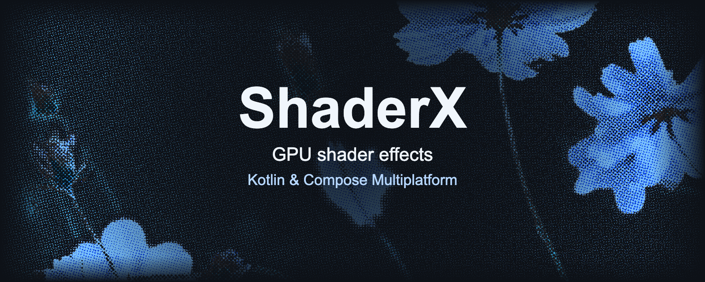

# ShaderX: GPU shader effects for Compose Multiplatform

{ .shaderx-banner width=1600 height=640 fetchpriority=high }

ShaderX is a Kotlin Multiplatform library for applying GPU shader effects to Compose UI. Use the same Kotlin API for Android's AGSL backend and the Skia backend on iOS, JVM desktop, and WebAssembly.

Start with grayscale, blur, gradients, or pixelation, then write a custom AGSL/SkSL shader when you need a different effect.

[Get started](getting-started.md){ .md-button .md-button--primary }
[Explore the effects](effects.md){ .md-button }
[Try the playground](playground/){ .md-button }

## See ShaderX in action

<video class="shaderx-demo" width="400" height="224" controls loop muted playsinline preload="none" poster="assets/demos/shader_lab_web-poster.jpg" aria-label="ShaderLab gallery running in a browser with live effect controls">
  <source src="assets/demos/shader_lab_web.mp4" type="video/mp4">
  <a href="https://raw.githubusercontent.com/Debanshu777/ShaderX/main/assets/shader_lab_web.gif">Watch the ShaderLab browser recording</a>.
</video>

The [sample gallery](samples.md) includes Android and WebAssembly ShaderLab recordings, a live ASCII camera, and a scroll-driven movie carousel, with source code and run commands for each.

For the project's background, read the companion article, [Building GPU Shader Effects for Compose Multiplatform: From Scratch to ShaderX](https://medium.com/gitconnected/building-gpu-shader-effects-for-compose-multiplatform-from-scratch-to-shaderx-326659c4f47b). Use these guides for the current API and platform limitations.

## Start building

| I want to… | Start here |
| --- | --- |
| Add ShaderX to an app | [Installation and quickstart](getting-started.md) |
| Check my target platforms | [Platform support](platforms.md) |
| Choose an effect | [Effect catalog](effects.md) |
| Animate effects or handle errors | [Compose integration](compose.md) |
| Write an AGSL/SkSL shader | [Custom effects](custom-effects.md) |
| Process image bytes | [Image processing](image-processing.md) |
| Run an example | [Sample applications](samples.md) |
| Fix a setup problem | [Troubleshooting](troubleshooting.md) |
| Contribute a change | [Contributor guide](contributing.md) |

<a id="releases-and-development-docs"></a>

## Release status

The published Maven Central version is **0.1.4**. The installation examples and guides describe that release, including session animation, texture inputs, and all 15 built-in effects. The [effect catalog](effects.md) distinguishes the nine effects already available in 0.1.3 from the six added in 0.1.4.

Check the [0.1.4 release notes](https://github.com/Debanshu777/ShaderX/releases/tag/v0.1.4) for the changes and retain the documented [platform limits](platforms.md). The repository and playground can include later source changes; [build locally](contributing.md#try-the-library-in-another-project) when testing a change that is not in your installed release.

## Source and API reference

ShaderX was created by Debanshu Datta and is [open source on GitHub](https://github.com/Debanshu777/ShaderX) under the [Apache 2.0 license](https://github.com/Debanshu777/ShaderX/blob/main/LICENSE). Kotlin packages start with `com.debanshu.shaderlab.shaderx`; the Maven coordinates are `io.github.debanshu777:shaderx`.

Generate the full KDoc reference from your checkout:

```shell
./gradlew :shaderx:generateDocs
```

Open `shaderx/build/dokka/html/index.html`. See [contributor setup](contributing.md) for the required toolchain.
