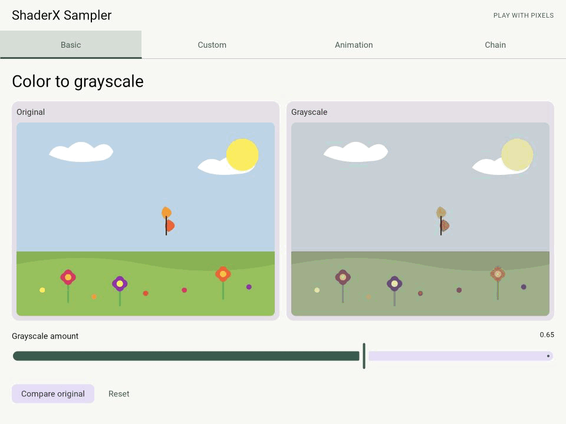
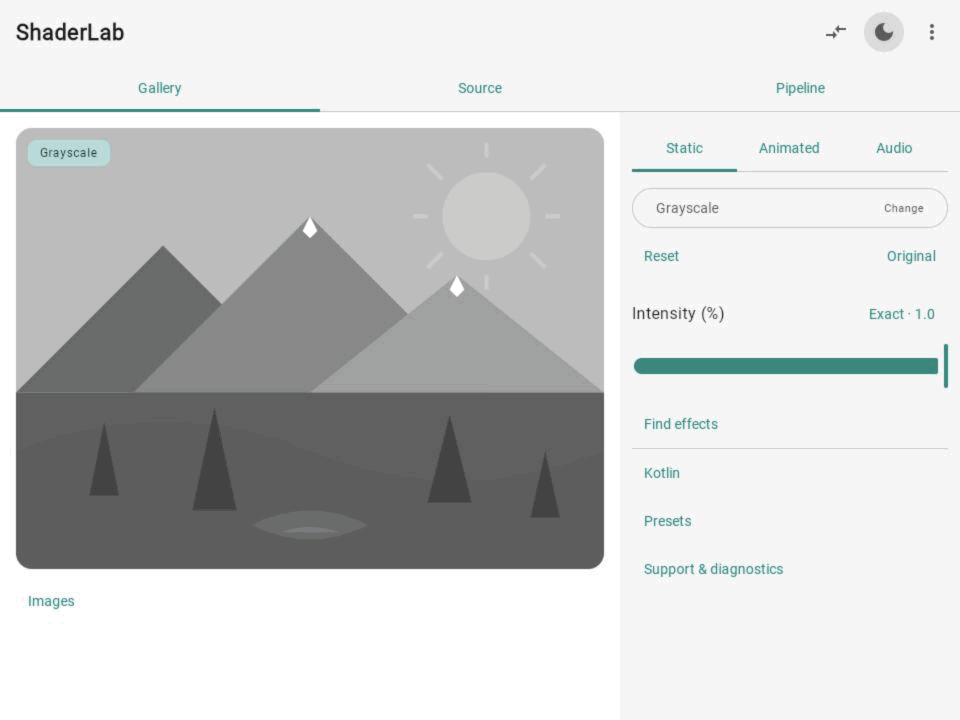
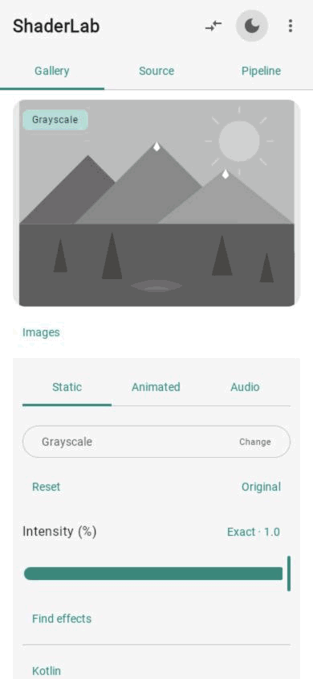

# Sample applications

Clone the repository and complete [local setup](contributing.md#local-setup) before running the commands below. On Windows, use `gradlew.bat` instead of `./gradlew`.

## Run the apps locally

Try [Sampler in your browser](sampler/) for four guided examples, or open [ShaderLab](playground/)
for Gallery, Source and Pipeline. The README's expanded **Live app demos** section previews both,
the narrow-browser layout, effect ordering, camera and carousel before linking here.

[Download the project source ZIP](https://github.com/Debanshu777/ShaderX/archive/refs/heads/main.zip),
extract it and complete [local setup](contributing.md#local-setup) with JDK 21 and the Android SDK.
From the extracted repository root:

```shell
# Run either app on desktop
./gradlew :samples:Sampler:composeApp:run
./gradlew :samples:ShaderLab:composeApp:run

# Or install on a connected Android device/emulator (API 33+ for runtime shaders)
./gradlew :samples:Sampler:androidApp:installDebug
./gradlew :samples:ShaderLab:androidApp:installDebug
```

The ZIP contains project source to build locally. Camera and carousel setup, including camera
permission and the optional movie-data token, is covered in their own sections below.

## ShaderX Sampler

[Open the visual sampler](sampler/) to experiment with four concepts in one app. Each tab
keeps a short source file in `samples/Sampler/composeApp/src/commonMain/kotlin/com/debanshu/shaderx/sampler`.
The app uses public SDK APIs and does not import ShaderLab's UI, registry, image or audio modules.
It consumes the local `:shaderx` project. Use the same checkout when following its definition, playback and chain examples.

| Tab | Try it | Source |
| --- | --- | --- |
| Basic | Compare original and grayscale, adjust the amount, reset | `BasicTab.kt` |
| Custom | Mix cool/warm tint, change strength, compare actual output with the original | `CustomTab.kt` |
| Animation | Play/pause, seek, change wave strength and speed without restarting time | `AnimationTab.kt` |
| Chain | Follow original → first stage → final; swap order and tune grayscale/gradient amounts | `ChainTab.kt` |

The Chain cards are actual ShaderX renders of the same bundled image, with a single effect in
the middle and the ordered composite in the final card. All tabs retain their chosen values
when switching. Animation's app-owned clock stops advancing off-tab and while the host is
inactive; returning resumes without catching up hidden time. Reset restores that tab's controls.
Explanations and shader/source snippets are optional details below the visual controls.



This new browser recording demonstrates grayscale adjustment, warm/cool tint, live wave playback
and chain reordering in the current checkout. It uses the real app, not the disposable README UI
studies. See [recording provenance](#current-readme-recordings) for capture dimensions and timing.


```shell
./gradlew :samples:Sampler:composeApp:run
./gradlew :samples:Sampler:composeApp:wasmJsBrowserDevelopmentRun
./gradlew :samples:Sampler:androidApp:installDebug
./gradlew :samples:Sampler:composeApp:wasmJsBrowserDistribution
./gradlew :samples:Sampler:composeApp:linkDebugFrameworkIosSimulatorArm64
```

The browser server prints its URL. Android installs one **ShaderX Sampler** launcher, requiring
API 33+ for these runtime shaders. Desktop/browser/iOS use Skia. The `Sampler` iOS framework
provides `MainViewController(active, reducedMotion)` for an embedding Xcode host; no standalone
Xcode project is included. Native factories and sessions remain composition-owned. Android feeds
activity resume/pause, browser feeds visibility/reduced motion, and desktop feeds window focus.

The packaged `/sampler/` browser route becomes hosted only after this work merges and the
merged-main documentation deployment succeeds. One app/runtime download serves all four tabs.
The advanced [ShaderLab playground](playground/), camera and carousel remain separate samples.

### Capture the sampler

The walkthrough above is a fresh capture of the current four-tab sampler. Use these flows
when refreshing it; the camera/carousel footage is separate from the new app recordings.

1. Serve the combined site using [local preview](contributing.md#preview-and-check-documentation).
   Open `/sampler/` on desktop and at 390×844. Wait for graphics startup.
2. **Basic:** compare original/result, move amount from 0 to 1, then Reset.
3. **Custom:** choose Warm, then Cool; adjust tint strength/temperature and open the shader details.
4. **Animation:** Play, Pause, seek to 5 s, change speed/strength, switch tabs and return, then Reset.
5. **Chain:** capture all three stages, Swap order, adjust both amounts and gradient palette, then Reset.

Keep actual errors visible and record the browser/device. A mobile viewport inspection proves
responsive layout, not physical Android/iOS GPU behavior.

## Current README recordings

The 20 November 2026 refresh replaces the README's old ShaderLab footage and adds the current
four-tab Sampler. Both production browser distributions were built from this checkout with
JDK 21 before capture. Interaction and pixels came from the running apps in the macOS in-app
browser; no UI was reconstructed or composited over the recording.

| Recording | Native viewport | GIF frames / duration | Demonstrated flow |
| --- | --- | --- | --- |
| Sampler | 960×720 | 40 / 14.14 s | Basic grayscale adjustment → warm/cool Custom → Animation play/pause → Chain swap order → Basic |
| ShaderLab desktop | 960×720 | 35 / 10.93 s | Grayscale Gallery → live Wave → successful Warm tint source run → color/dither pipeline and reorder → Gallery |
| ShaderLab narrow | 390×844 | 51 / 9.44 s | Grayscale → live Wave → effect picker → live Plasma |

The walkthroughs use captured screen frames with edited holds for readability and approximately
10-fps sampling during live animation. macOS ImageIO encodes the GIF palette; it adds no
interpolated motion or shader effects. Each GIF loops as an edited walkthrough, rather than
claiming a seamless mathematical period. All decoded frames, UI transitions and loop boundaries
were reviewed. FPS/timing badges visible in the app are transient UI readings, not benchmark results.

The two ShaderLab GIFs are mirrored at the README's existing `assets/shader_lab.gif` and
`assets/shader_lab_web.gif` paths. Their new labels explicitly say browser; camera and carousel
GIFs remain unchanged. The historical Android/browser MP4s below retain their original footage.
These captures establish Wasm/Skia presentation only, not physical Android/iOS GPU behavior.

## Optional image and backdrop recipes

The separate [`validation/ecosystem-consumer`](https://github.com/Debanshu777/ShaderX/tree/main/validation/ecosystem-consumer)
module demonstrates Coil 3.4.0 loading/success/error with retained ShaderX playback and Haze
1.7.2 source-backed blur with a separate clear foreground. It uses the local development library
and keeps both dependencies out of core. Follow the [task guide](ecosystem.md) and
[validation commands](contributing.md#ecosystem-integration-validation). Rendering, disposal and
platform checks are distinct gates; their actual scope is in the SX14 evidence.

Run the desktop demo from the checkout root:

```shell
./gradlew :validation:ecosystem-consumer:run
```

It loads the repository flower banner through Coil, lets you toggle a missing-file error, and
shows the Haze surface with clear foreground text. Scroll to desaturate the image through an ordinary Compose scroll-driven parameter; its paused
ShaderX playback remains independently owned.

## ShaderLab

The [ShaderLab app](https://github.com/Debanshu777/ShaderX/tree/main/samples/ShaderLab) targets Android, iOS, JVM desktop and Wasm. It opens in **Gallery** with Grayscale already applied. **Change** opens the complete effect list; Static, Animated and Audio choose the family. Primary tuning uses sliders/switches, while each **Exact** value or **Edit ARGB** reveals typed entry, alpha and metadata without rounding stored values.

Use the top navigation to switch to **Source** for custom shader authoring or **Pipeline** for ordered effect editing. The gallery's **Images** section reveals bundled/picked image selection. The top **Image actions** menu offers image export for picked input. **Find effects**, **Kotlin**, **Presets**, **Playback details** and **Support & diagnostics** are secondary disclosures; actual render/export/compiler failures remain visible when they occur.

Unsaved source/forms/current values, last-good image snapshots and keyed pipeline projects survive navigation among these views for the current app session. Leaving a tool closes its render sessions and stops its local playback driver; Workbench factories are also panel-local, while Gallery/Pipeline share the app's bounded cache. Returning resumes from retained scalar time without background catch-up. Reload/process death still requires explicit local save or draft recovery. Navigation never treats an invalid source draft as a successful run.

[Open the browser playground](playground/) to try the gallery without building it. The playground uses the development library from the same commit as its documentation deployment, rather than resolving a separate published artifact. Use a current browser with WebAssembly GC support. Audio capture requires HTTPS (or localhost) and microphone permission; the app requests that permission when you start capture.

The app and Skia runtime download when you open the playground, so the first visit can take longer on a slow connection. The loading screen links back to the guides and recordings if the browser cannot start it. The current GIF walkthroughs below remain available without running WebAssembly. The sampler has its own recording above.

**Desktop browser · current ShaderLab**



**Narrow browser · current ShaderLab**



Both are fresh captures of the checkout's WebAssembly/Skia app. The narrow recording uses a
390×844 browser viewport on macOS; it is not an Android device recording.

<details>
<summary>Earlier ShaderLab recordings · Android and browser</summary>

These older MP4s are retained as historical footage. The GIFs above and in the README show the current UI.

<video class="shaderx-demo" width="400" height="224" controls loop muted playsinline preload="none" poster="../assets/demos/shader_lab_web-poster.jpg" aria-label="ShaderLab running in a WebAssembly browser with live effect controls">
  <source src="assets/demos/shader_lab_web.mp4" type="video/mp4">
  <a href="assets/demos/shader_lab_web.mp4">Watch ShaderLab in the browser</a>.
</video>

<video class="shaderx-demo" width="400" height="898" controls loop muted playsinline preload="none" poster="../assets/demos/shader_lab-poster.jpg" aria-label="ShaderLab Android gallery demonstrating configurable shader effects">
  <source src="assets/demos/shader_lab.mp4" type="video/mp4">
  <a href="assets/demos/shader_lab.mp4">Watch the ShaderLab Android gallery</a>.
</video>

</details>


```shell
# Android device or emulator running API 33+
./gradlew :samples:ShaderLab:androidApp:installDebug

# Desktop
./gradlew :samples:ShaderLab:composeApp:run

# Browser development server
./gradlew :samples:ShaderLab:composeApp:wasmJsBrowserDevelopmentRun

# Production browser bundle
./gradlew :samples:ShaderLab:composeApp:wasmJsBrowserDistribution

# iOS arm64 simulator framework (macOS with Xcode)
./gradlew :samples:ShaderLab:composeApp:linkDebugFrameworkIosSimulatorArm64
```

For iOS, open `samples/ShaderLab/iosApp/iosApp.xcodeproj`, select a simulator, and run. Device builds require your own signing team. The web server prints its local URL; browser audio access needs localhost or HTTPS and permission.

`imagelib` and `audiolib` are sample modules for image access/export and audio capture/FFT. They are not published with the ShaderX library. The Pipeline view demonstrates ordered Android/Skia on-screen chaining; see [limitations](platforms.md#composition-limitations) for other platforms. Export on Android is subject to the current [image-processing limitation](image-processing.md).

The audio previews reuse the spectrum texture when the captured data and display bin count are unchanged. Android, desktop, and iOS publish read-only spectrum snapshots; the browser polls Web Audio each frame. Changing the bin-count slider still updates the texture without restarting microphone capture. `:samples:ShaderLab:audiolib:jvmTest` checks texture reuse, changed audio, and bin-count changes alongside the FFT and image-packing tests.

Native captures use one `SpectrumAnalyzer` per capture worker. It reuses FFT scratch arrays, Hann coefficients, bit-reversal indices, and twiddle factors while publishing a fresh result array for every audio buffer. Short reads use only the valid prefix without copying the PCM buffer. Tests compare its output exactly with the one-shot `Fft.magnitudes` implementation across window lengths and bin counts, and check that later frames never mutate published snapshots. The opt-in JVM diagnostic `SHADERX_AUDIO_BENCHMARK=1 ./gradlew :samples:ShaderLab:audiolib:jvmTest --tests '*SpectrumAllocationBenchmark' --rerun-tasks` compares warm one-shot and workspace allocations and CPU time on the current machine; it does not measure GPU frame rate or microphone latency.

Android and desktop open, read, stop, and close blocking microphone devices on `Dispatchers.IO`. Stopping a capture returns without joining a worker on the UI thread; retries wait for earlier devices to close, including across intervening denied or cancelled permission requests. Generation checks discard late permission or startup results, and failed reads terminate capture instead of spinning. Android capture generations share an in-flight permission prompt so cancellation cannot lose another waiter's result. Fake-device tests cover blocked shutdown, stop during startup, overlapping permission requests, retry, and cleanup without requesting microphone access. iOS keeps its native audio callback lifecycle and reuses PCM/FFT workspace storage inside the tap.

Picked-image previews decode once per selected byte array and requested size using `Dispatchers.Default`, with a loading state while decoding. The large preview is capped at 2048 pixels on its longest edge; gallery thumbnails request twice their displayed pixel size. Smaller images are never upscaled. Android decodes at the requested size; Skia scales into a bounded display bitmap without retaining a full-size decoded bitmap (decoder scratch memory can still depend on the format). Original encoded bytes remain available for full-resolution export. This moves decoding off the UI thread on Android, desktop, and iOS; browser dispatch remains on its event loop. Android and desktop image-picker reads use `Dispatchers.IO`. A newer selection or leaving the composition cancels pending delivery so a stale image cannot replace the current one. Both local-library samples scope their preview shader factories to the composition and close the cache on exit. Each blocking export owns a separate factory, closed in its worker after processing, so UI cache eviction or screen disposal cannot close native resources during export. Export disables repeated saves while it is running. If applying an effect fails, the sample shows the error and does not save an unfiltered image as a successful effect export.

### Capability and fallback guidance { #capability-and-fallback-guidance-in-development }

ShaderLab explains the selected effect's render and export support separately. Browser preview establishes Wasm/Skia behavior; Android AGSL and native targets still require their own validation. Unsupported chains retain the whole failure rather than silently skipping children. A creation error leaves the original image visible and identifies the fallback and its reason. Export checks the image-processing operation rather than relying on the legacy on-screen support Boolean, and a processing failure is never saved as a successful effect export.

These reports use [development capability metadata](platforms.md#operation-queries-in-development), which cannot guarantee arbitrary source compilation or resource allocation. Standalone animated effects use sessions; static composite rendering does not automatically clock animated children. Source-free background output is available through the development workbench; bounded data/nested Kotlin templates require caller-rebound inputs; the native Skia raw-image API remains unavailable. Kotlin integration output includes availability and platform requirements; it does not certify arbitrary source on Android or native targets.

### Edit and reuse an effect { #edit-and-reuse-an-effect-in-development }

The development playground uses a sample-local registry of built-in effects and custom
`ShaderDefinition` starters. Custom definitions use their rich `definition.schema`; legacy
built-ins use an explicit schema adapter. Registering a definition with float, color and boolean
parameters produces controls without another hand-written panel. Applications can still apply
an effect directly without using this registry.

Choose a bounded control's **Exact** value to enter numbers with the keyboard; unbounded floats show exact entry immediately. Sliders appear only
for useful finite bounds. Labels retain units, descriptions and semantic roles; decimal and step
hints never round the saved or exported values. Choose **Edit ARGB** to enter all eight sRGB ARGB hex digits,
including alpha, and boolean controls send true typed boolean updates. Reset restores schema
defaults. Gradient still preserves the source image's alpha in its rendering equation; storing
ARGB alpha does not change that historical behavior. Wave frequency describes spatial waves,
not playback speed.

Expand **Kotlin** in the gallery to export complete Kotlin for portable registered effects, including imports,
custom source/schema/bindings when applicable and Compose usage. It preserves exact numeric
values and ARGB alpha independently of control display formatting. Copy the output or select
the text if clipboard access fails. Generated examples target the library from the same checkout. The export reports platform requirements;
Wasm preview success does not prove that a custom program compiles on Android AGSL.

Presets contain a version, definition identity, schema version and ordered typed scalar values.
They refer to an already registered definition rather than storing executable Kotlin or inventing
a global definition service. Load errors explain unknown definitions, incompatible versions and
invalid values; reset or select a known starter before trying an incompatible preset again.
Images, live providers and borrowed native handles are nonportable and need application-side
rebinding. For declarative custom effects, Kotlin export emits caller-input templates requiring
`ImageBitmap` and, for live bindings, `ShaderFrameProvider` arguments. Binding names and structural
image tile modes are retained. The generated live composable takes `inputRevision` to refresh
complete snapshots; provider-returned images retain their own tile modes. Built-in audio exports
still report the need for application integration. Borrowed resources are never uploaded or serialized into a preset. Save/load uses one local slot, replaced
on save. Browser file exchange uses `.sxp` downloads and file input; desktop uses file choosers.
Android/iOS use selectable text import/export while native file pickers remain a gap. Format
limits and storage paths are recorded in the [playground validation record](https://github.com/Debanshu777/ShaderX/blob/main/validation/evidence/sx06-playground-and-reuse.json).

Custom tint uses packed sRGB ARGB and premultiplied output. Animated custom distortion binds
amplitude, resolution and seconds through explicit source aliases. The
[controlled playback seam](compose.md#controlled-playback-in-development) keeps playback
separate from parameter state so editing a slider does not recreate the timeline. Manual controls
accept a finite signed seek position in seconds (seeking pauses playback), and a finite
nonnegative speed multiplier. Zero speed holds the current position. Playback position and speed
are not part of a scalar parameter preset. Built-in audio previews keep their dedicated live-input path. Production hosts must supply lifecycle/visibility
and reduced-motion preferences; those platform integrations are not established by browser
controls. Source editing is available through the workbench below; the
[ordered pipeline editor](#ordered-pipeline-editor-in-development) uses a shared clock for animated chains.

## Author a custom shader { #author-a-custom-shader-in-development }

Use **Use form defaults (clear current overrides)** to recover after narrowing a range excludes a current value. This preserves source and form fields and requires Run; no value is silently clamped.

Choose **Source** in ShaderLab. **Warm tint** connects editable source,
a float `intensity` declaration, range `0..1`, an exact control and a complete SDK example.
Edit its pixel math, choose **Run shader**, adjust the validated control and inspect the new result.
Expand **Declarations & inputs** to edit the matching source/form declarations when adding a parameter. Renaming a source uniform
without updating **Uniform binding** produces an actionable mismatch on Run. Fix it and Run
before expanding **Last-good Kotlin** to copy the successful output. Float, color and boolean forms use the same SDK schema
and typed controls as the gallery.

The original/result pair is a bounded time-zero image-processing snapshot produced by ShaderX.
Animated has a separate controlled preview with Play/Pause/Reset; Distortion demonstrates pixel
coordinates and resolution. Image input blends the bundled image with REPEAT X / MIRROR Y.
The browser can choose a PNG up to 1 MiB and 256×256 pixels; native workbench image upload is
not supplied. Image arguments in exported Kotlin must be supplied explicitly by your app.
The workbench does not edit arbitrary live providers or raw data textures.

Draft source, form and values remain editable after failure. Preview and SDK output stay on the
last successful rendered revision and display **STALE** after any draft change. Copy requests
retain selectable code if clipboard access fails. Draft file/text exchange is a separate action
and may contain broken source; restoring never executes it or treats it as validated. Expand **Draft recovery** for Save/Restore, which
use a workbench-specific local slot; Reset overwrites that slot with Warm tint. Images and
last-good outputs remain session-only. Browser/desktop hosts offer project file exchange;
Android/iOS use local recovery and selectable project text.

Source is limited to 32 KiB, projects to 128 KiB, schemas to 32 parameters and preview input to
256px. There is no guaranteed synchronous Wasm/GPU timeout; reload a stuck page and reset
before restoring a known draft. Browser Run validates **Skia only**, never Android AGSL, and
no arbitrary Kotlin or uploaded binaries execute. Android's offline image-processing limitation
prevents a successful Content workbench snapshot there; Background runs use the on-screen AGSL
modifier instead. See the [authoring contract and supported
declaration subset](custom-effects.md#guided-source-authoring-in-development) and
[recovery instructions](troubleshooting.md#workbench-draft-errors-and-recovery).
Workbench/export contracts target the library from the same checkout.

## ASCIICamera

The [ASCIICamera sample](https://github.com/Debanshu777/ShaderX/tree/main/samples/ASCIICamera) applies custom ASCII shaders to an embedded CameraX preview using Compose rendering. It also includes an image tab. Grant camera permission and use an Android API 33+ device or emulator.

```shell
./gradlew :samples:ASCIICamera:androidApp:installDebug
```

<video class="shaderx-demo" width="400" height="898" controls loop muted playsinline preload="none" poster="../assets/demos/ASCIICamera-poster.jpg" aria-label="Live CameraX preview rendered as ASCII characters">
  <source src="assets/demos/ASCIICamera.mp4" type="video/mp4">
  <a href="assets/demos/ASCIICamera.mp4">Watch the ASCII camera preview</a>.
</video>

This demonstrates on-screen rendering. Performance depends on device, preview size, and effect.

Switching to the Image tab releases this sample's CameraX preview; changing cameras rebinds only its own use case. Image reads and decoding run off the main thread; the display bitmap is capped at 2048 pixels on its longest edge, and moving effect controls reuses it. To verify these paths on a device, pick a large image, move the cell-size slider, switch between Camera and Image, and flip cameras. The image should remain responsive and the camera should release when its tab disappears.

## VerticalCarousel

The [VerticalCarousel sample](https://github.com/Debanshu777/ShaderX/tree/main/samples/VerticalCarousel) binds effect parameters to a vertical movie pager.

```shell
./gradlew :samples:VerticalCarousel:installDebug
```

It consumes the local `:shaderx` project, matching ShaderLab, Sampler and ASCIICamera. The release validation therefore builds its shader integration against the same library sources.

For live movie data, add your TMDB API read access token to the ignored root `local.properties`:

```properties
TMDB_ACCESS_TOKEN=your_read_access_token
```

Without a working token or connection, the sample falls back to sample movie data. Never commit the token. See [TMDB authentication](https://developer.themoviedb.org/docs/authentication-application) for token setup.

<video class="shaderx-demo" width="400" height="898" controls loop muted playsinline preload="none" poster="../assets/demos/vertical_carousal-poster.jpg" aria-label="Movie cards scrolling through a vertical carousel with shader effects">
  <source src="assets/demos/vertical_carousal.mp4" type="video/mp4">
  <a href="assets/demos/vertical_carousal.mp4">Watch the vertical carousel</a>.
</video>

## Ordered pipeline editor { #ordered-pipeline-editor-in-development }

ShaderLab's Pipeline view reuses the registry, schema controls, preview and playback owner. Add repeated instances, select by explicit key, edit exact values and move children earlier/later. A separate bounded `ShaderLab-Pipeline 1` text preset preserves keys, order and per-definition schema versions; existing single-effect presets are unchanged. Invalid imports replace nothing. The adapter derives current U+001F addresses after reorder. Known built-in child playback flags are hidden because the global clock overrides them; ordinary custom GPU Boolean controls, including a field named `animate`, remain editable. Generated Kotlin clears after edits and uses a shared clock only when needed; images and live providers require explicit host integration and are rejected by this pipeline exporter. The workbench continues to use ImageProcessor snapshots and does not gain offline chain support.


## Source-free background workbench { #source-free-background-workbench-in-development }

Choose **Background**, then Run to create pixels behind an unchanged foreground label.
The output selector distinguishes Content from Background; only source with matching requirements
can Run. Changing the selector does not remove a `content` dependency for you. Background drafts,
last-good revision checks and SDK export share the existing workbench workflow. Promotion waits
for native creation and a matching Compose draw invocation; this is not GPU readback validation. Draft format 3
preserves the output choice and external input descriptions; formats 1 and 2 still load, with format 1 restoring as Content and still requires Run. Generated
background Kotlin requires the matching library and explicit application-owned image/live inputs.
See [Compose backgrounds](compose.md#procedural-backgrounds-in-development) for clipping,
padding, pixels, playback, fallback and per-backend cost.


## Color and print collection { #color-and-print-collection-in-development }

ShaderLab includes four static collection filters in `ShaderX.builtInEffects()`: color adjustment,
color matrix, ordered dither and halftone. Select an effect, edit its exact schema controls, then
use a named preset or expand Kotlin for a complete integration. Defaults are neutral; the named
presets deliberately reveal the adjustment or print pattern. Reset returns to neutral defaults.
The matrix exposes twenty scalar controls so its exact values use the same preset/export path.

| Preset ID (schema version 1) | Exact values changed from defaults |
| --- | --- |
| `color-punch-v1` | `brightness=0.05`, `contrast=1.2`, `saturation=1.25` |
| `matrix-red-blue-v1` | `m00=0`, `m02=1`, `m20=1`, `m22=0`; all other identity coefficients retained |
| `dither-print-v1` | `amount=1`, `levels=4`, `cellSize=2` physical pixels |
| `halftone-news-v1` | `amount=1`, `cellSize=8` physical pixels |

Pipeline's **Color → four-tone print** starter orders color adjustment before dither and reuses
the same registry/schema controls. Compare it with the original, reorder children, save the
pipeline preset and generate Kotlin. The filters need content; choose Content rather than
Background when writing a related custom shader. The existing workbench remains an explicit
source/form editing path, while collection presets retain all rich schema metadata directly.
See [color math and artistic sizing](effects.md#editable-color-and-artistic-collection-in-development).

Collection preset buttons appear immediately below the selected effect name, above parameter controls.
Use “Try Newsprint dots” or “Try Four-tone print” to see the artistic filters; Reset returns to the neutral SDK default.


## Explicit data and child-input recipes { #explicit-data-and-child-input-recipes-in-development }

ShaderX keeps image, numerical data and source-free child inputs distinct. Kotlin export
requires `Rgba8Data` and `ShaderNode` parameters for structural data/child declarations. Live data
and children require a retained `ShaderFrameProvider` and an explicit `inputRevision`; export does
not run that provider. Images, RGBA bytes, child definitions/values and callbacks are never embedded
in the exported source. Rebind each requirement in the receiving application and query its actual
factory's `RAW_DATA_TEXTURE`/`NESTED_SHADER` capability before rendering. Skia raw input is unavailable
with resolved Skiko 0.9.37.4; a browser image preview cannot validate Android raw-data behavior.

Workbench draft format 3 stores bounded named input requirements, kind, data sampling and tile
modes. It does not store payloads or certify portability. Imported requirements display rebinding
hints; application-specific inputs require a host adapter supplying `reboundInputs`/`frameProvider`
to the captured `WorkbenchRun.build`. The stock browser UI does not synthesize raw or child inputs.
Restoration and input edits still need Run and a current matching candidate before last-good preview
or Kotlin export can advance. Pipeline export continues to reject external/live inputs explicitly.

The sample-only `DataRecipes.fftBins` accepts 1–4096 already normalized finite FFT magnitudes,
rounds each value to the nearest 8-bit R channel and writes G/B=0, A=255. Capture, FFT, smoothing
and normalization belong to the application. A producer can call it after publishing a complete
FFT result, then expose `DataUniform("spectrum", snapshot)` from a retained frame provider and
increment the controlled playback input revision. Read bin `i` at `(i + 0.5, 0.5)` with nearest
sampling. Linear sampling interpolates numerical channels; alpha is an independent data channel.
This recipe provides no audio-capture infrastructure or upload-performance claim. See the
[custom-input contract](custom-effects.md) for bounds, ownership and backend restrictions.


For a small portable spectrum, explicitly choose the procedural numerical sampler rather than a raw
texture. This emits a source-free child shader with bounded numerical uniforms; it does not turn on
Skia raw-texture support. The helper allows at most 64 RGBA texels and 1024 uniform bytes, so aggregate
FFT bins in the application first:

```kotlin
import com.debanshu.shaderlab.playground.DataRecipes // ShaderLab sample only
import com.debanshu.shaderlab.shaderx.authoring.ShaderBinding
import com.debanshu.shaderlab.shaderx.authoring.ShaderNode
import com.debanshu.shaderlab.shaderx.authoring.rgba8Sampler
import com.debanshu.shaderlab.shaderx.uniform.DataSampling
import com.debanshu.shaderlab.shaderx.uniform.ShaderTileMode

val spectrum = DataRecipes.fftBins(floatArrayOf(0.25f, 0.75f))
val sampler = ShaderNode.rgba8Sampler(
    spectrum, DataSampling.NEAREST, ShaderTileMode.CLAMP, ShaderTileMode.CLAMP,
)
val binding = ShaderBinding.nested("spectrum", sampler)
```

Declare `uniform shader spectrum;` in the owning shader and read its R channel at bin centers.
The application recreates the immutable sampler after changed input data; it can publish that new
node through `frameNested` with a new revision. Each snapshot fixes numerical values and time;
independent producer clocks remain application-owned. `DataRecipes` is not part of the SDK artifact;
copy this small normalization/quantization recipe into the host or supply a validated `Rgba8Data`
directly. Exported Kotlin accepts the procedural sampler as an explicit `ShaderNode` argument.

## Export routes after SX13

The bounded `exportImage` API is additive; ShaderLab's existing image-save and workbench CONTENT
Run routes keep their legacy processing semantics. CONTENT Run still checks `IMAGE_EXPORT` and
stays disabled on Android. The BACKGROUND Run route uses its own native draw modifier and remains
independently available. The new API does not silently enable synchronous Android export on the
composition thread. A future CONTENT migration must use worker-owned native resources and preserve
current-revision/error/loading state and transactional last-good promotion. Keep original selected
bytes for explicit saves; failed processing must never save them as filtered output. See
[image export contracts](image-processing.md#bounded-png-export-in-development).
